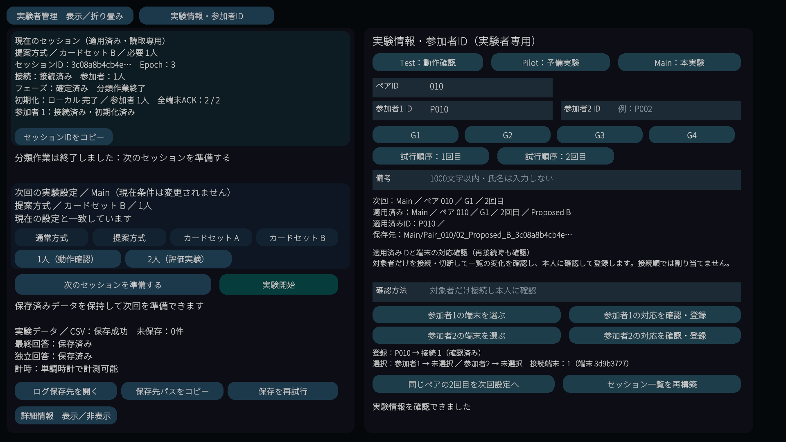

# CoPlace 実験データ管理・ログ保存構造の改善

実施日：2026-11-24。Unity 6000.3.17f1、既存のuGUI／TMP／STYLY NetSyncを使用。Package追加・研究条件の変更・カード操作ログの実装は行っていない。

## 1. 現状調査

`experiment-log-implementation.md`、`experimenter-ui-implementation.md`、`participant-ui-implementation.md`（第14・15節を含む）と最新実装を照合した。開始時の作業ツリーはcleanだった。変更前のScripts／Editorは `Temp/restore/data-management/` へ保存した。

従来は `ExperimentCsvLogStore` が常に `RootDirectory/SessionID/` に保存していた。Loggerが確定Snapshotをキューへ入れ、書込成功後だけキューから外す。失敗時は保持して再試行し、Reset前のflushが失敗すると新GUIDの発行前に拒否する。回答CSVは既存ファイルとの内容一致を確認する不変保存であり、変更していない。

Session ID／EpochとMode／Set／Expected Participant Countは既存Session Controlで同期される。Draftは次回設定、Appliedは新規準備で固定され、Start前にACK・設定一致・人数・Role・Idle・Logger・計時を中央判定する。これらを維持し、新しい研究用識別情報はPC側だけのメタデータとして関連付けた。参加者向けUI、回答・同意・公開・配置同期、既存通信キー、CSV列・イベントIDは変更していない。

## 2. 参加人数ログの調査結果

**従来の `participants_at_start` は人数ではなく、参加者RoleのClientNoを`;`で連結した一覧である。**

| 従来CSVの値 | 意味 | 新メタデータのactual_participant_count |
|---|---|---|
| `2` | ClientNo 2の参加者1人 | `1` |
| `1;2` | ClientNo 1と2の参加者2人 | `2` |

Loggerは `ExperimentParticipantRegistry.ParticipantClientNos` を使用し、Registryは生存端末のうちRoleが `Participant` のものだけを採用する。実験者や全ACK対象数は使っていなかった。したがって「1人なのに2」という指摘は、ClientNo一覧を人数として読んだ可能性と整合する。実験者を加算するコード上の原因は見つからなかった。従来列の意味・値は互換性のため維持する。

新しいメタデータ／一覧では、最初に保存されたStart行のClientNo一覧から重複を除いた整数人数を記録する。Start観測時にもRegistryを更新する。開始前は一覧の実人数欄を空にする。再接続や人数変化で開始時人数を後から書き換えない。1人・2人の既存実フロー、実験者ClientNo 99の除外、値`2`を1人と数える単体ケースを検証した。過去CSVの補正・上書きは行っていない。今回の検証はオフラインであり、指摘された特定の実機CSVそのものの再現試験ではない。

## 3. 採用した保存構造

```text
ExperimentLogs/
  session_index.csv
  Test/
    20261124_120000_123_Normal_A_<full-session-id>/
  Pilot/
    Pair_001/
      01_Normal_A_<full-session-id>/
  Main/
    Pair_001/
      01_Normal_A_<full-session-id>/
      02_Proposed_B_<full-session-id>/
  <legacy-session-id>/        # 従来のデータ。そのまま保持
```

各管理対象セッションには次を保存する。

```text
session_metadata.json         # 正本：固定した識別情報＋進行・保存状態
participant_bindings.csv      # 実験者が確認したID／接続端末の対応履歴
phase_events.csv             # 従来スキーマ
session.csv                  # 従来スキーマ
card_set.csv                 # 従来スキーマ
independent_answers.csv      # 公開後の提案方式のみ
final_placements.csv          # 確定後のみ
```

方式・セット・人数と実験情報を準備要求時にコピーし、フルSession ID・Epoch・作成UTCと合わせて保存先を決定する。通知要求が受理された後にメタデータを永続化する。CSVの単調時計originは従来通り最初のCSV観測時に作り、メタデータの作成時刻で計時境界を置き換えない。既存Resetの要求受付・受信・初期化・ACKの区別も維持する。

フォルダ名は短縮せずフルSession IDを使う。同じPair・試行順序の再実験でも別Session IDとなり、別フォルダへ保存する。既存メタデータの固定識別情報に矛盾する保存や同じSession IDの別保存先を拒否する。管理画面だけは長いSession IDを短縮表示する。

識別子はASCII英数字・`-`・`_`、最大40文字。ペアIDの英字は大文字に統一し、大小文字を区別しないファイルシステムでの別名衝突も防ぐ。Participant IDは `P`＋3〜12桁の数字。パス区切り、`.`、空白、不正な区分・方式・セット、改変した相対パスを拒否し、root配下のシンボリックリンクを辿らない。Notesは1000文字以内でCSVの引用符・改行をエスケープする。

## 4. メタデータのDraft／Appliedと割当

初期Draftは常に **Test**。Play再起動でも前回Mainだったことを根拠に次回をMainへ自動設定しない。旧Sessionの復元や過去データをMainへ自動分類しない。

Testでは方式・セット・人数を従来通り自由に選べる。Pair／Participant ID／Groupは必須にしない。ID未割当の接続は対応表で空欄のまま記録する。

Pilot／MainではPair ID、人数に対応する匿名Participant ID、Group、Trial Orderを必須にする。対応するペア研究の一覧スキーマに合わせて1人または2人を扱い、2人ならID2も必要、1人ならID2は空欄にする。同一セッション内のID重複、同じ実験区分内で別ペアに使われたPID、同じペアの参加者・割当変更を拒否する。同じペア・順序の再試行は許可し、別Session IDで残す。

| Group | Trial 1 | Trial 2 |
|---|---|---|
| G1 | Normal A | Proposed B |
| G2 | Proposed A | Normal B |
| G3 | Normal B | Proposed A |
| G4 | Proposed B | Normal A |

区分・Group・順序の変更に従って次回Mode／Setを決める。Pilot／Mainでは自由選択ボタンを無効化し、既存 `SetDraft` APIから直接違う条件を指定しても拒否する。Expected Participant Countは既存のDraft／Applied同期をそのまま使う。

Pair／PID／Group／Order／Notesも準備時にコピーする。試行中のDraft変更でAppliedや保存先・CSV条件は変わらない。実験情報の未適用差分もUIと中央Start判定へ反映する。確認ダイアログ中に実験情報が変わると、既存の接続・Session・Epoch・条件変更の場合と同様に取消す。

正常終了・保存済みのTrial 1では「同じペアの2回目を次回設定へ」を使える。AppliedのPair／PID／Group／人数を引き継ぎTrial 2のDraftを用意するだけで、ResetもStartも自動実行しない。実験者が改めて新規準備し、ACKと対応確認を経て開始する。

## 5. Participant IDとClientNoの対応

参加者の接続順・表示順からPIDを推測しない。実験者が適用済みPIDに対して端末ClientNoを明示選択し、本人・端末を確認した方法を入力して登録する。確認手順の例は、対象者のQuestだけを接続・切断して一覧の変化を確認し、本人に確認すること。参加者VR UIに技術情報や新たな確認画面を追加していない。

端末の識別には既存NetSyncの `GetDeviceIdByClientNo` を利用し、SHA-256にしたdevice keyを保存する。実験者Role、未接続端末、端末識別が取れない状態、確認方法のない登録、別の現在接続へ重複したPIDを拒否する。Pilot／MainのStartは、全参加者の適用済みPIDとの対応確認が揃わないと中央APIからも拒否する。Study IDをネットワークへ送っていない。

ClientNoまたはdevice keyが変われば未確認となる。再接続後は実験者が再確認して新しい履歴行を追記できる。RoleがParticipantでなくなった対応もID解決に使用しない。Play再起動・新セッションでは対応表を自動採用せず、再確認を求める。試行中に対応が不明な接続のログはPIDを空欄とし、既存のClientNoを保持する。過去の対応行や回答CSVを後付けで書き換えない。

`Data.TryResolveParticipant(clientNo, out id)` は、現セッションで確認済み・接続中・Participant Role・同じdevice keyの場合だけ成功する。未確認ならfalse／空欄を返す。

## 6. CSVスキーマ・状態管理・一覧復旧

`session_index.csv` のschema_versionは1。列は以下の順序で、Session IDをキーとして1行に集約する。

```csv
schema_version,session_id,session_epoch,experiment_type,pair_id,participant_1_id,participant_2_id,allocation_group,trial_order,condition,card_set_id,expected_participant_count,actual_participant_count,created_at_utc,started_at_utc,finished_at_utc,status,save_status,log_path,app_version,exclusion_reason,notes
```

`log_path`はExperimentLogsからの相対パス。作成・開始・終了時刻はUTC。`actual_participant_count`は開始時の参加者数、`app_version`は準備時のApplication.version。exclusion_reasonは未指定の空欄とし、システムが分析対象や除外試行を勝手に選ばない。

| status | 意味 |
|---|---|
| preparing | 準備要求を受け付けた／初期化中 |
| prepared | Reset同期完了、開始前 |
| in_progress | 開始済み、未確定 |
| completed | 最終確定を観測済み |
| aborted | 既存SESSION_ABORTEDを記録した途中中断 |

save_statusはpending／complete／failed。completedとcompleteの両方を確認して保存済み正常終了を抽出する。準備データの保存がcompleteであっても、status=preparedは終了試行ではない。回答確定時にはまずpendingとし、最終回答（提案方式では独立回答も）と既存イベント・サマリー等の保存を終えてcompleteとする。IO失敗はキューに保持し、可能なら正本へfailedを記録する。ファイルシステム全体が書けない場合は失敗状態自体も永続化できないため、実行中のLoggerエラー・未保存件数を併せて確認する。

`participant_bindings.csv` は追加専用の対応履歴である。

```csv
schema_version,session_id,session_epoch,participant_id,participant_client_id,device_key,confirmed_at_utc,observer_run_id,reason,role_at_confirmation
```

対応表とフェーズCSVでobserver_run_idを共有する。既存 `independent_answers.csv` はSession ID／Epoch／participant_client_idで結合できる。フェーズCSVの個人イベントは `participant_id=client:N` のNを取り出す。最終回答は共同結果なのでSession ID／Epochを介してPairと結合する。再接続時は対応履歴・観測run・時刻も確認し、空欄や曖昧な対応を接続順で補わない。

正本の `session_metadata.json` はschemaVersion、固定したSession ID／Epoch／createdAtUtc／condition／cardSetId／expectedParticipantCount／relativePath／appVersion／planと、進行・保存状態を保持する。planはexperimentType、pairId、participant1Id、participant2Id、allocationGroup、trialOrder、notes。更新はflushした一時ファイルから置換し、直前の正常版を `.bak` に残す。

一覧は正本を走査して生成する派生ファイル。Test／Pilot／Main配下だけを対象とし、従来のSession ID直下フォルダを自動移行・分類しない。主メタデータが壊れた場合はbackupで復元する。主・backupの両方が読めない、またはSession IDが重複する場合、部分的な一覧で既存indexを置換せずエラーにする。一覧更新だけの失敗は回答保存と区別し、データを消さず管理UIで再構築できる。正本も復元できない場合は対応を推測しない。

## 7. 管理UI

既存の実験者管理Canvasへ「実験情報・参加者ID」を追加した。右側の編集パネルは任意に開閉でき、既存の詳細情報とは排他的に表示する。区分、Pair／PID、Group、順序、Notes、Draft／Applied、保存先、端末選択・確認、2回目Draft、一覧再構築をまとめた。入力欄は常時ラベルとクリップ領域を持ち、氏名を入力しない案内を表示する。

日本語表示には既存ExperimenterJapanese SDFへ必要文字を追加した。atlasサイズを増やさず、Participant／カード用フォントは変更していない。uGUIのCanvas・RectTransform・入力フィールド／EventSystemの文書を参照した。Sceneの全面Setupは実行していない。



画像は**EditorのオフラインPreview Scene**。匿名ID・端末識別・1人構成はテストデータであり、Quest実機・本番データの画面ではない。入力ラベル、文字枠、確認済み表示、無効化した方式選択を描画後に確認した。

## 8. 分析と将来の拡張

- Mainかつstatus=completedかつsave_status=completeで、保存済み本実験候補を抽出できる。
- Pair ID・Group・Trial Order・Condition・Card Setで通常／提案の対応を確認できる。
- experiment_typeとParticipant IDを匿名アンケート結果の結合キーに使い、ClientNoとの対応履歴から回答ログへ結合できる。区分をまたいで番号を再利用した場合に、Participant IDだけで結合しない。
- 同じPair・Orderに複数の完了Sessionがあっても全件を保持する。どの試行を分析対象とするかは実験者が明示的に決める。

将来のcard_operations.csvには `Logger.SessionDirectory(sessionId)`、`Logger.Data.Applied`のコピー、`Logger.Data.TryResolveParticipant`、`Logger.ObservationRunId`を再利用できる。保存先を独自に組み立てたり接続順でPIDを付与したりしない。新ファイルの書込は既存の保存キュー／再試行／Reset前flush・未保存判定へ組み込む必要があり、保護を迂回して直接書き込まない。今回は拡張用の抽象基底クラスや汎用ログフレームワークを追加せず、**card_operations.csv自体は実装していない**。

## 9. 変更ファイル

| ファイル | 内容 |
|---|---|
| `Assets/Scripts/ExperimentDataPlan.cs`＋meta | 区分・匿名ID・割当・入力検証 |
| `Assets/Scripts/ExperimentDataStore.cs`＋meta | 保存先・正本・対応表・index・原子的更新／復旧 |
| `Assets/Scripts/ExperimentDataManagement.cs`＋meta | PCのDraft／Applied、手動対応、2回目Draft |
| `Assets/Scripts/ExperimentDataManagementUI.cs`＋meta | 既存管理Canvasの編集パネル |
| `Assets/Scripts/ExperimentCsvLogStore.cs` | 共通保存先解決、追加メタデータの状態更新 |
| `Assets/Scripts/ExperimentLogger.cs` | 保存基盤の利用、対応記録、人数・index警告、共通観測run |
| `Assets/Scripts/ExperimentSessionManager.cs` | 準備前検証、割当のAPI guard、準備情報の固定 |
| `Assets/Scripts/ExperimentLobbyController.cs` | メタデータ／対応確認の中央Start guard |
| `Assets/Scripts/SessionResetUI.cs` | 管理パネル、未適用差分、確認の取消、選択無効化 |
| `Assets/Editor/ExperimenterControlPanelSetup.cs` | 管理UIの新文言をフォント生成対象へ追加 |
| `Assets/Resources/ExperimenterJapanese SDF.asset` | 日本語グリフ追加 |
| `Assets/Editor/ExperimentDataManagementVerification.cs`＋meta | 保存・復旧・割当・人数・Main2試行・管理UIの専用検証 |
| `Assets/Editor/AnswerLoggingVerification.cs`／`PilotCardSetVerification.cs`／`ExperimenterControlPanelVerification.cs`／`ParticipantUIVerification.cs`／`ExperimentLoggerVerification.cs` | 共通保存先API／階層探索を使用。既存の検証意図は維持 |
| `docs/experiment-data-management-verification/` | 自動検証結果 |
| `docs/experiment-data-management-samples/` | 実生成した隔離テストの保存例 |
| 本書・UI画像 | 報告・運用手順 |

## 10. 自動検証と保存例

最新の詳細結果は [集計](experiment-data-management-verification/summary.json) を参照。Unity 6000.3.17f1の隔離複製プロジェクトで13系統を実行し、各JSONのpassed／failureを確認した。すべてGUID付きテストrootを使い、本番CSVは検証入力にしていない。

| 検証 | 結果 |
|---|---|
| ExperimentDataManagementVerification | PASS 139 |
| ParticipantUIVerification | PASS 2,659 |
| ProposedRevealVerification | PASS 74 |
| ProposedSharedPlacementVerification | PASS 44 |
| IndependentAnswerSubmissionVerification | PASS 14 |
| ExperimentLobbyVerification | PASS 39 |
| ExperimentResultVerification | PASS 78 |
| ExperimentLoggerVerification | PASS 29 |
| ExperimenterControlPanelVerification | PASS 209 |
| PilotCardSetVerification | PASS 433 |
| AnswerLoggingVerification | PASS 378 |
| AnswerSnapshotStoreVerification | PASS 18 |
| CardDropVerification | PASS 1,163 |

専用検証ではTest／Pilot／Main分離、4グループ×2順序、ID不足・重複・パス不正・大小文字別名、Draft／Applied、再試行の不変保存、index重複防止・破損／消失再構築、正本backup復旧、復旧不能時のindex保持、実験者除外の人数、手動ID対応と端末変更、MainのNormal A→Proposed Bの2試行、保存完了と正常終了、SESSION_ABORTED非生成、確認中のDraft変更取消、Participantからの管理API拒否を検証した。

既存の通常／提案・1／2人・A／B、提出／取消／公開、参照・共同分類・同意・終了、保存失敗時のReset拒否・再試行、旧CSVのバイト保持、単調時計・フェーズ時間の回帰検証を維持した。既存テストの保存先組み立て・直下フォルダ探索だけを新しいAPI／階層に合わせて更新し、安全判定を緩和していない。

[保存例](experiment-data-management-samples/session_index.csv) は専用検証で実際に生成されたログから採取した。Mainの1人構成は実験機器1台での運用確認用のテストシナリオであり、本実験データではない。実験本番の2人構成を1人データで代替したものではない。

EditorコンパイルとAndroid向けC#コンパイルを確認した。既存Android response fileに存在しないVisual Scripting生成AotStubs 1件はコンパイル入力から除外して検査した。APK／IL2CPP全体のビルド・Quest実機検証は未実施。

## 11. 実機検証手順

1. PC／Questを同じコードで用意する。端末間通信可能な同じWi-Fiでサーバーへ接続し、ゲストWi-Fiの端末間隔離を避ける。検証はテスト用ログroot／Roomで行う。
2. 初期Testで1人を選び、通常方式Aと提案方式Bを完走する。日時・方式・セット付きTestフォルダ、indexのexpected／actual=1を確認する。旧participants_at_startはQuestのClientNo一覧であることを確認する。
3. PilotまたはMainを明示選択し、Pair ID、P形式の匿名ID、Group、Orderを入力する。未入力・重複・不正ID・割当と違う条件が拒否されることを確認する。本実験では意図した2人構成と2つのPIDを選ぶ。
4. 新規準備後、対象者だけを接続／切断して端末一覧の変化と本人を確認する。PIDごとに端末を選び確認方法を記入して登録する。未確認ではStart APIも拒否されること、確認後に開始できることを確認する。
5. 1回目を正常終了・保存完了し、2回目Draftボタンを押す。同じID・Groupと正しい次回条件になるが、自動Reset／Startされないことを確認する。新規準備、ACK、端末対応の再確認を経て2回目も完走する。
6. 同じPair・Orderを再試行し、別Sessionフォルダで過去回答が保持されることを確認する。途中中断を別途行い、status=abortedとSESSION_ABORTEDが保存され、正常終了試行には付かないことを確認する。
7. 再接続でClientNoが変わった場合、PIDを自動推定せず再確認できること、対応履歴に新行が増え旧行・旧回答が保持されることを確認する。端末識別が不明なら無理に割り当てない。
8. 検証用indexだけを退避して再構築を試す。保存先を一時的に書込不能にする試験はテスト用rootだけで行い、未保存表示・Reset拒否・復旧後のキュー再試行・Session ID不変を確認する。本番CSVで試さない。
9. Quest 2台では両者のPID確認、ClientNo／Roleの差、両方式・両セット、片側再接続とACK、独立回答CSVの結合、参加者UIに管理情報が出ないことを確認する。

## 12. 既存データへの影響・残存課題

旧フォルダの削除・移動・改名・自動分類はしない。メタデータのない復元Sessionは従来保存先を利用し、新しいStartには従来通り現在runでの明示準備を要求する。旧CSVの列・値の追加補正、既存回答の上書き、経過時間の後付けは行っていない。参加者向けUI・Scene・カード・研究条件・ネットワークキー・時間計測の境界は変更していない。

正本とbackupが両方失われた場合は識別情報を推測せず、データ保全後に外部バックアップから復旧する必要がある。index再構築は識別情報を持つ新形式データだけを扱う。Rootを別場所へ変えたデータの自動収集や旧形式の手動移行UIは今回追加していない。

実際の本人と端末の対応は実験者の確認に依存する。device keyの一致だけで本人の同一性を保証するものではない。保存済み対応の自動推定はしない。大規模データのindex更新性能、複数PCが同じrootを同時管理する運用は未検証で、運用は1つの実験者PC／rootを前提とする。OSの強制終了・電源断の全タイミングを網羅した耐障害試験は未実施。

匿名アンケートの収集、分析対象の最終選択、除外理由の自動判定、カード操作ログは対象外。残る実機確認とAPK／IL2CPPの最終互換性確認を本実験前に行う。
