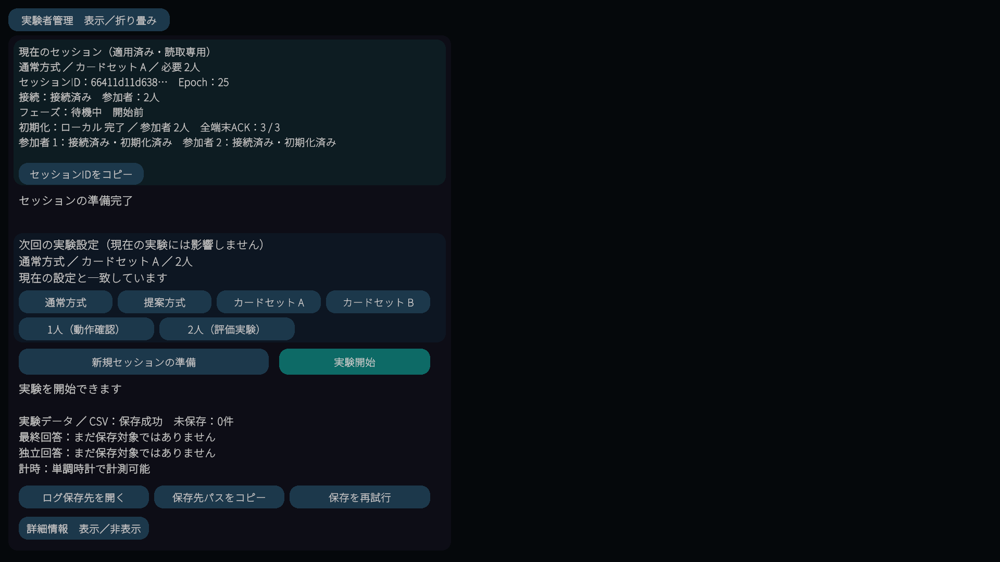
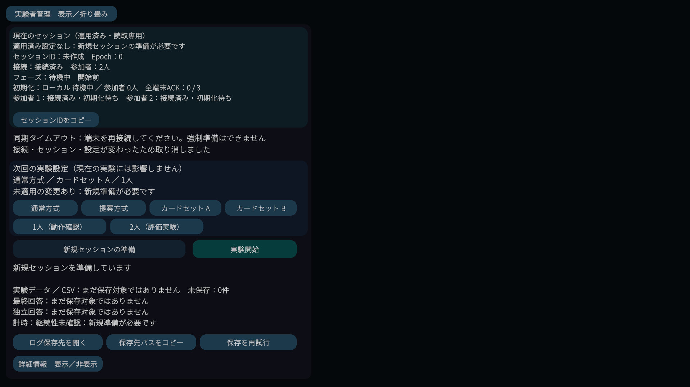
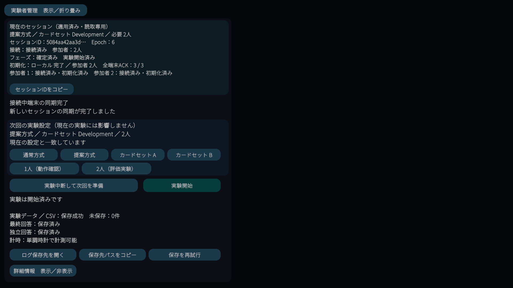
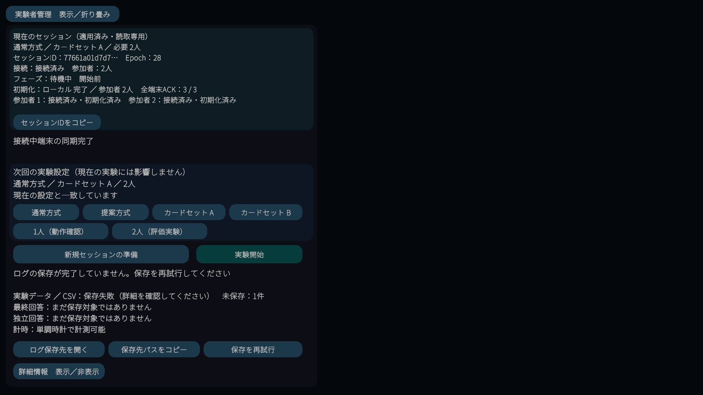

# CoPlace 実験者管理UI 第1段階 実装報告

実装日：2026-11-20。対象：W1〜W6、既存Resetによる中断、W8の実験者向け日本語表示と回帰検証。

## 1. 実装内容

PCの実験者用uGUIを、折り畳み可能なScreen Space Overlayへ統合した。方式・カードセット・必要人数は次回設定として編集し、確認後の既存Resetで一括適用する。参加者のWorld Space UI、回答・公開・同意・最終確定の研究上の処理は維持した。

実装前に調査レポートと作業ツリーを照合した。開始時の変更は `Assets/Scenes/QuestSetup.unity` と未追跡の調査レポートのみ。Sceneの既存変更を含む実装前コピーを `Temp/restore/experimenter-ui/` に保存した。調査レポートは変更していない。本番CSVを検証に使っていない。

## 2. 変更ファイル一覧

| ファイル | 内容 |
|---|---|
| `Assets/Scripts/ExperimentSessionManager.cs` | Draft、Applied、設定ACK、実処理に基づく準備状態、既存Resetへの設定適用 |
| `Assets/Scripts/ExperimentParticipantRegistry.cs` | 適用済み人数を優先し、実験途中のInspector変更から保護 |
| `Assets/Scripts/ExperimentManager.cs` | 旧方式選択APIをDraftへ接続、Reset中の方式適用、異なるRoom方式の適用防止 |
| `Assets/Scripts/ExperimentLobbyController.cs` | 中央の開始判定強化、日本語の具体的な拒否理由 |
| `Assets/Scripts/ExperimentLogger.cs` | 稼働・保存・回答保存状態、再試行、現在runの準備証明 |
| `Assets/Scripts/ExperimentCsvLogStore.cs` | 単調時計originの読取APIのみ追加 |
| `Assets/Scripts/SessionResetUI.cs` | 統合管理画面、確認・取消、コピー、保存先表示、詳細情報 |
| `Assets/Scripts/ExperimentLobbyUI.cs` | PC実験者の旧Lobby管理表示を非表示 |
| `Assets/Scripts/ExperimentResultUI.cs` | PC実験者の旧Result管理表示を非表示、参加者側は維持 |
| `Assets/Scenes/QuestSetup.unity` | 特定した孤立Canvas 4個のみ削除 |
| `Assets/Editor/ExperimenterControlPanelSetup.cs` と `.meta` | 専用日本語Static SDFの生成・更新メニュー |
| `Assets/Editor/ExperimenterControlPanelVerification.cs` と `.meta` | 管理・設定・同期・保存保護の専用検証、解像度別プレビュー |
| `Assets/Editor/ExperimentLobbyVerification.cs` | 統合UI・Draft・明示準備の新しい前提へ更新 |
| `Assets/Editor/ExperimentResultVerification.cs` | 統合UIからの開始・準備と参加者Resultの回帰 |
| `Assets/Editor/PilotCardSetVerification.cs` | Reset前のDraft選択、完了表示 |
| `Assets/Editor/AnswerLoggingVerification.cs` | 1人／2人の各試行で設定を準備時に適用 |
| `Assets/Editor/CardDropVerification.cs` | カードセット・方式を準備時に適用 |
| `Assets/Resources/ExperimenterJapanese SDF.asset` と `.meta` | 管理UI専用フォント |
| `docs/experimenter-ui-scene-cleanup.json` | 削除対象と保持確認の記録 |
| `docs/experimenter-ui/` | 最新の検証結果JSONと画面プレビュー |
| 本ファイル | 実装・検証・運用手順 |

既存Setupの全面再実行、Package追加、CSV列・イベントID・既存通信キーの変更はしていない。

## 3. 重複UIの整理結果

削除したGameObjectのfileID：`50628292`、`1039180215`、`2081270360`、`2105247976`。すべて名前が `ExperimenterSessionReset` のSceneルートで、各11 GameObject／48 serialized blockだった。Canvas、CanvasScaler、GraphicRaycaster、Image、TMP、Buttonのみ。外部参照なし、永続onClickは空であることを再確認した。

削除は計44 GameObject／192 blockとSceneRootsの4参照に限定した。実装前作業ツリーのSceneと比較し、残存blockはSceneRoots以外すべて同一であることを検査した。既存の未コミット変更も保持されている。詳細は [整理記録](experimenter-ui-scene-cleanup.json)。

`EnsureResetUI()` は同じGameObjectのコンポーネントを再利用し、`DisallowMultipleComponent` と生成済みroot確認で重複を防ぐ。Canvasは所有コンポーネントの破棄時に破棄される。Button listenerはBuild時に一度だけ登録する。UIはネットワークイベントへ追加購読せず、既存manager／Loggerの購読解除を維持した。オフライン検証では同一Sceneに管理Canvasが1個、参加者Sceneには0個だった。

## 4. 管理画面の構成

暗色・青緑・角丸を使用し、左側約850/1920幅に配置。現在のセッションと次回設定を別背景で区切り、右側は観察用に空ける。上端ボタンで折り畳める。

- 現在：適用済み方式・セット・必要人数、接続人数、各参加者の接続／初期化、短縮Session IDと全文コピー、Epoch、フェーズ・進行状態。
- 同期：ローカル初期化、参加者初期化人数、実験者を含む全同期対象ACKの分母・分子、準備状態。
- 次回：通常方式／提案方式、A／B、1人（動作確認）／2人（評価実験）、未適用差分。
- 操作：新規準備、実験中断して次回を準備、実験開始。
- データ：CSV状態、未保存件数、最終／独立回答の保存状態、計時、保存再試行、保存先を開く・パスコピー。
- 詳細：OS例外・保存先・同期失敗の技術情報。通常表示には生の例外を混ぜない。

実験者Roleかつ非mobileの場合のみ生成・表示する。旧Lobby／Resultの管理操作を表示しない。参加者用World Space UIは維持した。Developmentは内部APIと既存検証用に残し、通常管理画面の選択肢には出していない。

## 5. Draft／Appliedの管理方法

DraftはSession managerの非永続ローカル値。初期値は提案方式／A／2人。`SetDraft(mode,set,count)` は実験者のみ利用でき、準備中は変更できない。人数の内部処理は正の整数を扱い、1／2の固定値にしていない。

新規準備時にDraftを既存Session Controlの `mode`、`cardSetId` と追加の `settingsVersion=1`、`expectedParticipantCount` にコピーし、ID／Epochと同じレコードで通知する。同一IDで方式・セット・人数・version・Epoch・ownerを書き換える通知は受け付けない。

各端末はReset内でセット・方式・人数を適用してからACKする。人数の読取はAppliedを優先し、旧人数同期は準備済みSessionの条件を上書きできない。旧方式APIも現在方式を変更せずDraftを変更する。

`experimentSessionSettingsAck` を追加し、ID・Epoch・方式・セット・人数の一致を確認する。既存の通信キーは改名していない。旧Controlに追加フィールドがない場合はAppliedを未定義として扱い、Startを拒否する。古い人数を推定して補わない。

## 6. Resetの進行状態と完了条件

既存の `StartNewSession`／`ResetSession`、保存確認、初期化、Room echo、ACK barrierを使用する。要求受付と完了は別である。

1. 前回の必要な回答・イベントを確認し、既存キューを保存。失敗なら新IDを発行しない。
2. Reset要求を受付し、送信待ちの間も操作をロック。
3. 新Controlを受信し、ローカルのカード・状態・方式・人数を適用。
4. 初期値のechoを確認して現Session IDのACKを送信。設定signatureも照合。
5. ownerは接続中の全同期対象のACKと初期値echoを確認し、active Controlを送る。
6. active受信後に既存の状態復元とローカル完了イベントを実行。
7. 接続中端末の同期完了と必要参加者の充足を別表示し、中央のStart条件を満たして初めて「準備完了」。

30秒はタイムアウト表示のための既存期限であり、完了推定には使わない。進捗率は表示しない。初期化失敗・owner切断ではguardを維持し、同期中に別GUIDを発行する復旧を追加していない。ownerが同じ接続IDで復帰できない場合や初期化を継続できない場合は、保存確認後に構成を修復し、全端末とRoomを運用上再起動する必要がある。実行中の自動Resetはしない。

確認ダイアログは現在ID／Epoch／接続クライアントとRole一覧／Draftを記録し、取消・接続変更・対象変更・設定変更を検出すると破棄する。連打時は既存managerのpending／resettingで二重要求を拒否する。

## 7. 実験開始の判定条件

中央は引き続き `ExperimentLobbyController.StartBlockReason`／`CanStart`。`StartExperiment()` の直接呼出しも同じ判定を通る。

実験者Roleの同期、接続・initial sync、ID／Epoch・active・ID echo、Reset非処理中、Appliedあり、ローカル方式一致、Draft差分なし、全同期対象の現Session ACKと設定signature、必要人数との完全一致、各参加者のRoleとIdle、Logger稼働、未保存／保存失敗なし、現在Logger runの新規準備証明、単調時計origin、Start非重複を確認する。日本語で具体的な拒否理由を表示する。

## 8. Play再起動への対応

準備証明はLoggerの非永続フィールド。UIからの準備要求を既存Resetが受理した際に、その新IDを現在のLoggerへ記録する。復元Control・復元Start・CSVの存在から準備証明を作らない。新IDでの保存と当runの単調時計originが揃うまでStartできない。

Logger無効化・再有効化・再生成・Play再起動では証明を引き継がない。新しい実験には「新規セッションの準備が必要です」と案内する。復元された進行中のStart・回答・確定状態を自動Resetしない。過去CSVの空欄elapsedを補正する処理は追加していない。

## 9. ログ保存状態の判定方法

稼働は有効コンポーネント・購読済み・PC実験者の条件から、未保存件数は既存キューから取得する。保存中フラグは同期書込処理の実行区間を示す。短い同期書込は一フレーム未満で終わり、表示上観測できないことがある。

最終／独立回答は `store.Record()` が回答CSVと対応イベントの保存を例外なく完了した時だけ保存済み集合へ追加する。LastErrorが空という理由だけでは回答保存済みにしない。確定前・公開前・通常方式の独立回答は「まだ保存対象ではありません」と表示する。

再試行は現在のsnapshot確認と既存キューのDrainを使い、Sessionを発行しない。保存先は既存LoggerのOutputDirectory。フォルダがまだない場合はその旨を案内する。フォルダ表示はOSのfile URLハンドラ、コピーはsystem clipboardを使用する。CSV削除・上書き操作はUIに追加していない。

## 10. 日本語化・フォント

今回の実験者用管理画面、確認、エラー案内、方式・フェーズは日本語。C#識別子・Enum・CSV・イベントIDは維持した。技術用語のCSV／ID／Epoch／ACK／Loggerは識別のため残す。

管理UIはResourcesの専用 `ExperimenterJapanese SDF` を明示して使用する。NotoSansJPを元に、管理UI・Session・Lobby・Loggerのソースに含まれる文字とASCIIから必要集合を生成し、2048角・48ptのStatic SDFへ格納する。既存参加者フォント・カード文字集合は変更していない。追加Packageはない。

更新メニューは `Tools > Experiment > Update Management Japanese Font`。新しい文言はこの生成定義で再生成できる。旧Lobby／Result Setupが作る管理部品は元から初期非表示であり、更新したRuntimeも常に非表示にするため、旧管理UIは復活しない。Scene全体のSetupは実行不要。

uGUI実装時は、インストール済みpackageの `UICanvas.md`、`script-CanvasScaler.md`、`UIBasicLayout.md`、`EventSystem.md` とUnityスキルのuGUI・デザイン・CLI検証資料を参照した。

## 11. 自動テスト・回帰テスト結果

Unity 6000.3.17f1の検証専用複製プロジェクトを使用。作業用Editorのメインスレッドが応答しなかったため、Assets／Packages／ProjectSettings／Libraryを `Temp/ManagementVerificationProject` に複製してバッチ検証した。専用GUID付きログrootを使用した。本番Roomには接続していない。

最新結果は [集計JSON](experimenter-ui/verification-summary.json) と同フォルダの各詳細JSONを参照。

| 検証 | 結果 |
|---|---|
| 管理UI・セッション安全性 | PASS 209 |
| PilotCardSet | PASS 433 |
| Lobby | PASS 39 |
| Result | PASS 78 |
| Logger | PASS 29 |
| AnswerSnapshotStore | PASS 18 |
| AnswerLogging | PASS 378 |
| CardDrop | PASS 1163 |

管理検証はNormal／Proposed、A→B→A、1→2→1→2、現在条件の不変、未適用Start拒否、人数不足・超過、旧ID ACK・異なる設定ACK、取消・二重準備・準備中Start、Participant API拒否、Logger継続性喪失、旧形式Control、Logger欠落、初期化失敗、owner切断、保存失敗・復旧・中断記録を含む。

既存の回答ログ検証は1名／2名で正常・中断・保存失敗・復旧・旧CSV保持・独立回答と最終回答を確認した。経過時間・旧runのnull originはLogger／Store検証で確認した。コンパイラのRuntime／Editorコンパイルも成功した。

プレビューは1920×1080、1280×720、1280×800で取得し、描画対象TMPのfont coverageとpreferredHeightによる縦方向の文字切れを検査した。見た目のレビューでLobby参照不足と現在欄の文字重なりを修正し、再撮影して確認した。

失敗した試行も記録する。最初の `-nographics` バッチは既存PilotのCamera.RenderでSIGSEGVとなり、描画有効で再実行した。Static SDF再読込時の更新処理も修正した。追加で実行した旧 `ProposedRevealVerification.Run` と `ProposedSharedPlacementVerification.Run` は、初期Sessionを用意しない単独phase fixtureの最初の前提で失敗した。これらは今回変更しておらず、成功扱いしない。同じ公開・同意・共同分類の実処理は、新しい準備経路を通るPilot／AnswerLogging／Resultで通過している。単独fixture自体の現行Lobbyへの移行は残る。

## 12. Quest 1台での動作確認手順

1. PC EditorとQuestへ同じ変更を含むコードを用意する。PCのRoleはAuto（Editor＝実験者）、QuestはAuto（Player＝参加者）。サーバー／Roomは既存手順で事前起動する。
2. PCでPlay開始。古いSessionが見えても自動Resetされないことと、未準備のStart拒否を確認する。
3. 管理UIで1人（動作確認）・通常方式・Aを選び、新規準備を押す。一度取消して状態が保持されることを確認する。
4. 再度確認して準備。新ID／Epoch、ローカル・参加者初期化、全端末ACK、準備完了を確認する。PC＋Questなら通常は全端末ACK 2/2、参加者初期化1人になる。
5. 実験開始。Questで分類・同意・確定し、PCで最終回答CSVの保存済みを確認する。保存先表示とコピーを確認する。
6. 次回を提案方式・Bに変更し、現在方式が変わらないことを確認する。新規準備後に独立回答・提出・公開・共同分類・最終同意を行う。最終／独立回答の保存状態を確認する。
7. 未完了試行を明示中断して新規準備し、前SessionのSESSION_ABORTEDとCSV保持を確認する。
8. 準備後に次回条件を変更しStartが拒否されること、2人設定では1台だけで開始できないことを確認する。
9. 保存済み試行の後にPlayを停止・再開始。古いSessionで新試行が開始できず、新規準備後はelapsedが記録されることを確認する。実験途中の再起動では回答・状態が自動消去されないことも確認する。
10. Game Viewでボタン操作、折り畳み、ログ保存先表示、Scene再ロード後の重複なしを確認する。Quest側に管理UIが出ていないことを確認する。

本手順は未実施。実験本番とは別のRoom・テストデータで行う。

## 13. Quest 2台で確認が必要な項目

両Questでの管理UI非表示、2名の条件一致、独立回答16件と最終8件、片側ACK遅延、late join、提出／公開／同意、片側切断・再接続、owner切断時の停止、実LANでの連続試行、両端末のRay／Direct入力と可読性。1人⇄2人切替では人数超過を勝手に無視せず、明示切断してから開始可能になることを確認する。

オフライン2名検証は実施済みだが、Quest 2台の通信検証とは区別する。

## 14. 残存課題・互換性

- Quest 1台／2台での実機確認、Finder実起動・クリップボード内容の手動確認、Playを跨いだ実LANの復元確認は未実施。
- 管理UIはRuntimeで生成する。Scene再ロード時の所有オブジェクト破棄と単一生成は実装したが、実Editorでの再ロード操作は未実施。
- 単独の旧phase検証fixture 2本には初期Sessionの準備が必要。今回の統合経路の検証結果と混同しない。
- PCとQuestは同じSession Control拡張・設定ACKを実装したビルドを使用する。旧Questビルドは追加設定ACKを返せず準備完了できない。混在運用は禁止し、Quest APKを再ビルド・再配布する。
- Unity 6000.3.17f1でRuntime／EditorコンパイルとEditorバッチ検証済み。Android向け既存response fileでのC#コンパイルも成功（現存しないVisual Scripting生成AotStubs 1件は検査入力から除外）。macOS Standalone／Android IL2CPPの実ビルド・実機起動は未実施。新たなEditor依存はRuntimeへ追加していない。
- 初期化失敗・復帰不能なowner接続では強制復旧しない。保存確認と外部の全端末／Room再起動が必要。
- 参加者の全面日本語化、Pair ID、アンケート、管理者代理操作、サーバーRuntime管理は対象外のまま。

## 15. 実装後の画面

以下は**実装したuGUIをUnityのオフラインpreview sceneで描画したプレビュー**である。静的モックではないが、Play中の実Game View／実Questのスクリーンショットではない。作業用EditorはPipelineのmain-thread timeoutとなり、Computer Useの画面取得もタイムアウトしたため、その画面は取得できなかった。プレビューは撮影時だけCanvasをcamera描画へ切り替え、撮影後にOverlayへ戻している。背景は観察用の空き領域であり、実Tier Boardとの重なり確認は実機手順に残る。

通常・準備完了：

準備中（期限超過を注入した同期待ち。期限で完了扱いにしない）：

実験終了・回答保存確認（Pilotの実際の確定フロー）：

保存エラー（検証専用保存先のI/O失敗）：

小さい解像度： [1280×720](experimenter-ui/normal-1280x720.png)、[1280×800](experimenter-ui/normal-1280x800.png)。

## 追記：ビルド時のCS0103修正

2026-11-20、PilotCardSetVerificationから管理画面の撮影用クラスを直接参照する1行を削除した。カードセット検証に不要な別検証クラスへの依存をなくし、追加スクリプトがコンパイル入力にない場合でもカードセット検証をコンパイルできるようにした。既存のカードセット・回答・CSV検証は維持する。上記confirmed画像は削除前の撮影結果であり、Pilot検証の再実行では今後この管理画像を自動生成しない。

作業用Unity Editorで再コンパイル完了、errors=[]、scriptCompilationFailed=falseを確認した。追加の管理検証クラスを意図的にコンパイル入力から除いたEditorコンパイルと、Android向けC#コンパイルも成功した。APK全体の再ビルドはこの修正確認では実行していない。
