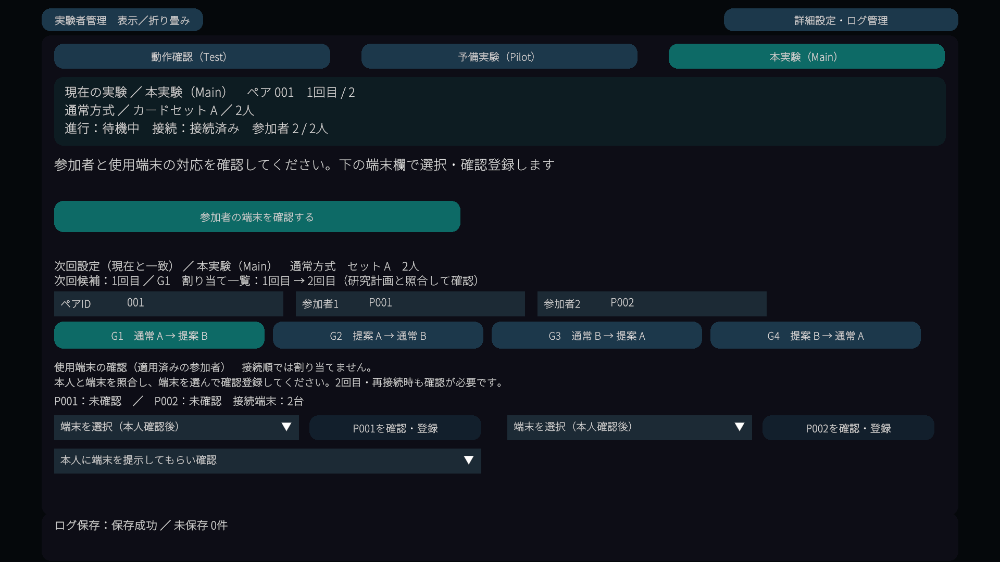
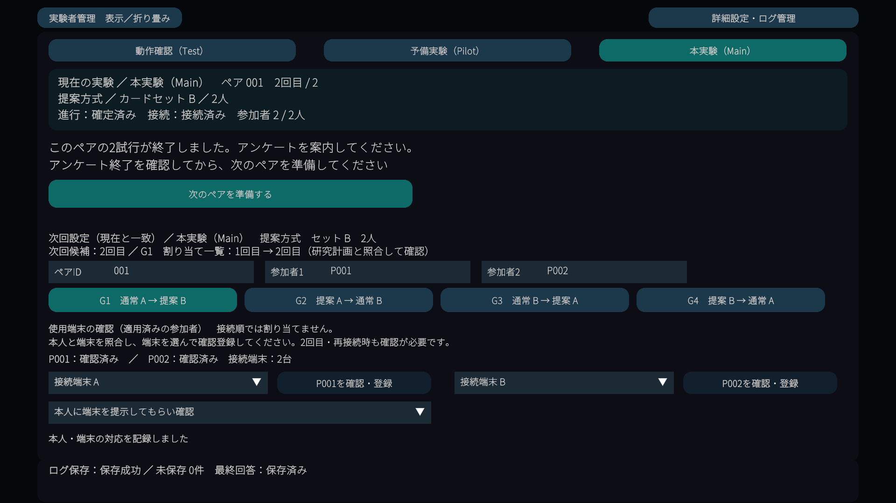
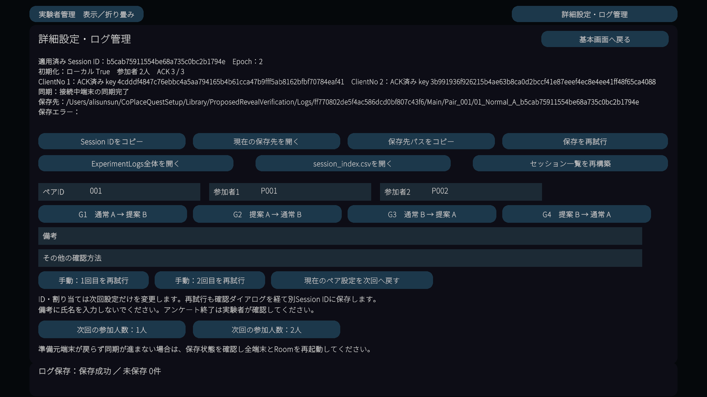

# CoPlace 実験者管理UIの簡略化・実験進行支援

実装日：2026-11-25。Unity **6000.3.17f1**、既存uGUI／TMPを使用。Unity本体・Package・参加者向けVR UI・通信プロトコル・CSVスキーマは変更していない。

## 1. 事前保全と現状調査

依頼された4報告書（experimenter-ui、participant-ui、experiment-log、experiment-data-management）と現行コードを照合した。開始時の未コミット変更60ファイルを `83a86a5` にcommitし、**実装前に origin/main へpush**した。ローカル復元用コピーは `Temp/restore/ui-simplification/`。

従来は左のSession管理と右の研究情報管理を往復し、ID・割り当て・試行順序を入力し、方式／セット／人数との整合を確認して新規準備した。その後、端末を順送りで選び、確認方法を自由記述し、各参加者を登録して別のStartボタンを押した。正常終了後も「2回目をDraftへ」と「新規準備」が別操作だった。Session ID・Epoch・ACK・ログボタンが通常操作と並び、次の操作と現在／次回条件が見分けにくかった。

## 2. 改善後の画面と操作

左右パネルを廃し、暗色背景・青緑アクセントの1画面へ統合した。

1. 上部で**次回設定の**Test／Pilot／Mainを選ぶ。現在適用済みの区分・方式・セット・人数・試行番号は別の読取専用カードに表示する。
2. 画面中央の短い案内と主要ボタンに従う。現在の状態から毎回表示を計算し、独立した実験状態は保存しない。
3. 下部で次回条件、研究用IDと割り当て候補、適用済み参加者の端末対応を確認する。
4. 下端の保存状態・重要警告は、詳細設定や折り畳み中も表示する。背景も暗色で固定し、実シーンの背景色に埋もれないようにした。

### Test

初期値は従来どおりTest。通常／提案、セットA／B、1人／2人の選択と、接続・進行・保存状態・主要操作を表示する。選択中の条件は青緑で示す。Pair ID／Participant ID／Group／試行順序の入力欄は基本画面に出さず、ID・端末登録なしで準備・開始できる。内部APIのDevelopmentセット互換性は保持するが、基本画面にDevelopment選択ボタンは設けない。

### Pilot／Main

新しいペアのID候補とG1候補を表示 → 研究計画との照合・修正 → 「セッションを準備する」→ ID・条件の確認ダイアログ → 既存Reset／ACK → 本人・端末の明示確認 → 「実験を開始する」→ 分類・最終同意 → 保存完了 → アンケート案内 → 「2回目の実験を準備する」→ 確認ダイアログ・Reset／ACK → 端末の再確認 → 手動開始 → 保存完了・アンケート案内 → 「次のペアを準備する」。

「2回目を準備」は既存 `PrepareSecondDraft` と既存Reset確認をつなぐ。準備とStartを自動実行しない。「次のペア」は新しいDraft候補を作るだけで、再度の確認・準備・Startが必要。アンケート完了フラグや回答収集機能は追加していない。

2回目が正常終了していても、同一区分・ペア・参加者・Groupについて1回目の正常終了／保存完了の正本がなければ「1回目の記録を確認してください」と表示する。手動で2回目だけを行ったケースを、2試行終了と誤表示しない。この照合結果は現Appliedセッション単位でキャッシュする。

### 主要操作の判定

| 既存の状態 | 表示・操作 |
|---|---|
| 未準備・Draft差分・今回の準備証跡なし | セッションを準備する |
| Reset中 | セッションを準備しています（無効）／既存のタイムアウト・失敗理由 |
| 接続・同期待ち | 参加者の準備を待っています（無効）／日本語の中央開始拒否理由 |
| 研究IDと端末の対応不足 | 参加者の端末を確認する（端末選択リストを開く） |
| 中央CanStart成立 | 実験を開始する |
| Start送信中／進行中 | 開始同期中／分類作業中（無効） |
| 確定後の未保存 | データを保存しています（無効） |
| Logger保存エラー | 保存を再試行する。次試行・次ペアへ進めない |
| 1回目の正常終了・保存済み | 2回目の実験を準備する |
| 両試行の正常終了・保存済み | 次のペアを準備する |

実験中の途中中断は副次ボタンとして分離し、既存の確認ダイアログ・保存前flush・SESSION_ABORTEDを維持した。互換用の旧Startコントロールは非表示で、そのinteractable判定も中央CanStartに従う。

## 3. ID候補と割り当て

- `session_metadata.json`（既存バックアップ復旧を含む）を走査する。indexだけが消失・破損しても重複発行しない。読めない正本がある場合は候補生成を拒否する。
- PilotとMainは既存仕様どおり別のID集合。同じ番号が区分間で使われ得るため、区分を明示する。
- 使用済み番号を避ける最小の正整数を3桁以上で表示する。例：001、P001、P002。数値として同じ001／0001等も候補の重複回避対象にする。IDそのものの既存検証は変更しない。
- 同じ実行中に準備したメタデータも候補判定へ含める。1人設定では参加者2は空欄。
- 候補生成は予約・永続化・Appliedの変更をしない。実験者は基本画面または詳細設定で変更でき、確認ダイアログを経て準備する。
- 再試行は詳細の「現在のペア設定を次回へ戻す」「1回目／2回目を再試行」を使う。AppliedのID・Groupを引き継ぎ、既存Resetによる新Session ID／別保存先で記録する。
- Groupは既存の4通りを維持し、各ボタンに**1回目→2回目**を一覧表示する。G1は固定の初期候補であり、ランダム化・人数均等化・自動割り当てではない。研究計画に沿って実験者が選び、確認する。

| Group | 1回目 | 2回目 |
|---|---|---|
| G1 | Normal A | Proposed B |
| G2 | Proposed A | Normal B |
| G3 | Normal B | Proposed A |
| G4 | Proposed B | Normal A |

## 4. 端末確認・詳細設定・ログ管理

接続端末をリストから選ぶ方式へ変更し、初期選択は「未選択」。表示順でParticipant IDを割り当てない。適用済みの各IDについて未確認／確認済みを表示し、実験者が本人・端末を照合して確認登録する。

確認方法は「本人に端末を提示してもらい確認」「対象者だけ接続・切断して本人に確認」「その他」の3択。その他だけ詳細設定に自由記述する。ClientNo／device keyと匿名IDの既存対応履歴へ追記し、過去の対応を書き換えない。

新セッション、接続切断通知、PC接続のReady再通知、接続集合・Role・device keyの変化、Logger無効化では対応を無効にする。元のdevice keyへ戻っても確認済みに自動復帰しない。進行中の接続異常・対応不明は常時警告し、途中中断後の再確認を案内する。Testの開始条件には対応確認を追加しない。

詳細設定は基本画面と切り替わる単一パネル。Session ID／Epoch／ClientNo／key／ACK／同期状態、IDとGroupの手動設定、備考、再試行・人数設定をまとめた。ログ管理には現在の保存先、ExperimentLogs全体、パスコピー、indexを開く／再構築、保存エラー詳細、保存再試行を配置した。

## 5. 安全性・互換性

Session Manager／Lobbyの既存Reset・ACK・中央Start・GUID／Epoch管理をそのまま使用する。UIからの進行も中央APIを迂回しない。保存中・保存失敗時の次試行を拒否し、確認中の接続・Session・Epoch・Draft変更で確認を取り消す。

回答・時間ログ、CSV列、保存先構造、匿名ID検証、Appliedの不変性、正常終了／中断の区別は保持した。過去回答を変更する処理、カード操作ログ、アンケート収集、新しい通信キーやPackageは追加していない。参加者UIの本番コード・元シーンには変更なし。

Unity 6000.3で利用できるAPIだけを使用し、最終コンパイル成功。Pipelineの旧コマンド名を使用した。EditorプレビューではTMP_DropdownのStartが通常のPlayと同様には実行されないため、プレビューでのShow試験はPlay検証へ分離した。Package更新による回避は行っていない。CLIの接続時互換性検出は未登録の `editor status` を試すため、最終Consoleにもそのエラー2件が残った。最終のUI動作例外・コンパイル失敗ではない。

### 既存研究ファイルの比較と検証上の事象

検証開始時と終了時の103ファイルをSHA-256比較した。**全94 CSVと全99非backupファイルはバイト一致、追加・削除0**。ただし初回のPlay確認で一時オフライン設定が引き継がれず、既存Loggerが保存済み状態を再観測したことで、以下の**バックアップ2件は更新された**。

- `session_index.csv.bak`
- `Pilot/Pair_TEST001/01_Normal_A_ebc7d279551f486ab5a31aa2427d769e/session_metadata.json.bak`

元の回答・時間CSVとメタデータ正本は同一。初回確認では準備／Startを操作せず停止し、その後はオフライン設定を保存した一時シーンコピーとLibrary配下の隔離保存先で確認した。バックアップの復元や研究ファイルの削除・上書きによる後処理はしていない。全ファイル不変とは報告しない。[比較結果](experimenter-ui-simplification-verification/research-data-integrity.json)。

## 6. 変更ファイル

| ファイル | 変更 |
|---|---|
| Assets/Scripts/SessionResetUI.cs | 統合画面、状態に応じた主要操作・案内、詳細パネル、常時警告 |
| Assets/Scripts/ExperimentDataManagementUI.cs | 候補確認、割り当て一覧、端末リスト、確認定型文、手動設定・再試行 |
| Assets/Scripts/ExperimentDataManagement.cs | DraftへのID候補、対応の無効化、保存済み1回目の照合 |
| Assets/Scripts/ExperimentDataStore.cs | メタデータ正本からの未使用ID候補生成。既存保存処理は維持 |
| Assets/Scripts/ExperimentLogger.cs | 接続変化・無効化時の対応無効化のみ。ログ列・時刻境界は変更なし |
| Assets/Resources/ExperimenterJapanese SDF.asset | 新しい案内文の日本語字形 |
| Assets/Editor/ExperimenterUISimplificationVerification.cs（＋meta） | UI操作・ID候補・両区分1/2人・2試行・障害・手動再試行検証 |
| Assets/Editor/ExperimentDataManagementVerification.cs | 再接続後は再確認が必要という要件への期待値更新、旧パネル表示フラグの廃止 |
| AgentScripts/verify_experimenter_ui_runtime.cs | Play中の表示・プルダウン検証の再実行用（eval_file） |
| 本報告書・専用検証JSON・simplified画像・Play画像 | 実行結果と操作手順 |

元の報告書用画像は過去の記録として保持した。一時検証シーン・生成画像のAssets内コピーは片付け、Play開始シーン・元シーンのoffline設定・実行前の背景実行設定を復元した。

## 7. 自動検証

Unity 6000.3.17f1 Editorで実行。全件成功。PreviewScene＋offline transport＋GUID保存先による統合試験であり、Quest実通信の成功を意味しない。件数には下位検証を呼ぶものと個々のカード／表示要素チェックが含まれるため独立ケースとして単純合計しない。

| 検証 | 成功チェック数 |
|---|---:|
| 実験者UI簡略化 | 215 |
| 既存データ管理 | 140 |
| 既存管理UI・同期・Start／Reset | 209 |
| 回答・時間ログ | 378 |
| 回答不変保存 | 18 |
| Logger | 29 |
| Result・正常終了／中断 | 78 |
| 参加者UI | 2659 |
| カードセット | 433 |
| Lobby | 39 |
| Submit／Cancel | 14 |
| Reveal | 74 |
| 共有分類同期 | 44 |
| Play中の表示・プルダウン・入力環境・重なり | 112 |

再実行：Editorの `Tools > Experiment > Verify Simplified Experimenter UI`。Play検証は元シーンのオフラインコピーと隔離保存先でMainのDraftだけを表示してから、`unity command eval_file -- --file AgentScripts/verify_experimenter_ui_runtime.cs --timeout 15000`。研究用Roomで障害試験を行わない。

[一覧](experimenter-ui-simplification-verification/summary.json)／[UI検証](experimenter-ui-simplification-verification/simplification.json)／[Play検証](experimenter-ui-simplification-verification/runtime.json)。

ID重複・index欠損・数値別表記・区分分離・正本破損時の拒否、未確認端末の中央Start拒否、切断／device変更後の再確認、各区分1/2人のNormal A→Proposed B、2回目の再確認、保存失敗中の停止、次ペアがDraft候補のみであること、手動再試行のID保持、2回目だけではペア完了としないことを検証した。既存試験で再試行の別GUID／別保存先、旧CSV保持、保存再試行、全Group／両セット、正常終了と中断、参加者Role・ACK・計時の条件も確認した。

画面は1920×1080、1280×720、1280×800で確認。文字切れ検出で確認方法欄と重要警告の高さを修正し、再撮影した。Play中にフレーム進行を確認してから、プルダウン開閉・定型文選択、単一EventSystem・Input System UI Module、文字切れ・ボタン重なりを検証した。プルダウンの意図的な全面Blockerは重なり違反から除外した。実シーン上の保存状態の背景も修正し、再確認した。

開発途中の検証失敗（文字切れ、旧互換ボタン、検証コードの変数競合等）と意図したI/O障害はConsole履歴に残る。Consoleは消去していない。最終の成功結果を専用フォルダに保存した。

## 8. スクリーンショット

以下は合成モックではなく、自動検証の実コンポーネントを描画したもの。初期・完了・保存障害はoffline preview、Play画像は元シーンの一時オフラインコピーによる実Game view。

その他：[初期画面](../Documentation/ExperimenterUI/simplified-initial.png)、[Test](../Documentation/ExperimenterUI/simplified-test.png)、[保存失敗](../Documentation/ExperimenterUI/simplified-save-error.png)、[1280×800](../Documentation/ExperimenterUI/simplified-main-1280x800.png)、[Play基本画面](experimenter-ui-simplification-play.png)、[Play詳細](experimenter-ui-simplification-play-details.png)。

## 9. 初めての実験者向け：Quest 1台の実機確認手順（未実施）

1. PCで既存QuestSetupを開く。通常のRoomへPCとQuestを接続する。PCはExperimenter、QuestはParticipant。
2. PCのTestで「通常方式」「カードセットA」「1人」を選ぶ。「セッションを準備する」→ 条件を確認して準備。同期完了まで待つ。ID入力・端末登録は不要。
3. Questが接続され「実験を開始する」になったら説明を済ませ、押す。Questで全カードを分類して最終同意。PCで分類終了・保存成功を確認する。
4. 詳細設定から現在の保存先を開き、今回のCSVを確認する。保存済みの前回データが別フォルダに残ることを確認する。
5. 1人のままPilotを選び、ID候補と研究計画のGroupを確認して準備する。本人にQuestを示してもらい、端末リストから選び、確認方法を選択し「Pxxxを確認・登録」。未確認ではStartできないことを確認する。
6. 1回目終了・保存成功後にアンケートを案内する。終了を実験者が確認してから「2回目の実験を準備する」→ 確認して準備。端末対応をもう一度確認・登録し、手動で開始する。
7. 2回目終了・保存成功後もアンケートを案内する。「次のペアを準備する」で新しい候補だけが表示され、勝手にResetやStartされないことを確認する。
8. 詳細設定の開閉、ログ管理、途中中断の取消を確認する。障害試験は既存研究ログを壊さず専用テスト保存先で行う。

1台手順は開発確認用。本実験を2人で行う際はTestの人数を2人へ戻してからPilot／Mainの新ペアを選び、ID2も確認する。

## 10. Quest 2台の実機確認手順（未実施）

1. PCのTestで2人を選び、その後PilotまたはMainを選ぶ。ID候補2名と予定Groupの「1回目→2回目」を管理表と照合する。
2. 「セッションを準備する」→ ID・条件を確認して準備。両Questの接続・同期を待つ。
3. 片方ずつ本人とQuestを照合する。接続順で決めず、必要なら対象者だけ接続・切断して端末を特定する。各IDで端末選択・定型文・確認登録を行う。片方だけ確認した状態ではStartできないことを確認する。
4. 画面の「実験を開始する」を押し、1回目を実施。提案方式では2名の独立回答・公開、両方式で全員の最終同意を確認する。
5. 保存成功を確認してアンケートを案内する。終了を確認したら2回目を準備し、同じPair／Participant IDと正しい別条件が表示されることを確認する。両端末を再確認してから開始する。
6. 2回目終了・保存成功・アンケート終了確認後、次ペアの候補を用意する。旧2試行の保存先とCSVが残り、IDが重複しないことを確認する。
7. 開始前の切断・再接続で未確認に戻ること、実験中の切断で重要警告が出ることを専用テストで確認する。不明な対応を接続順で埋めず、途中中断・再準備・本人確認を行う。

## 11. 残存課題

- Quest 1台／2台の実通信、実験者による本人確認の運用、APK／IL2CPPの最終確認は未実施。
- ID候補は単一の実験者PC／保存先を前提とし、候補のプロセス間予約はしない。割り当ての最終方針は研究側で決める。
- 既存のRAM保存キュー・電源断時の未保存回収・全ファイル一括トランザクションの制約は従来どおり。今回のUI変更で再実装していない。
- 初回Play確認に伴うbackup2件の更新は上記のとおり。研究データ正本・CSVの不変性と、backupを含む全ファイルの不変性を区別する。
