# CoPlace 参加者向けVR UI 第2段階 実装報告

実施日：2026-11-20。Unity 6000.3.17f1、既存uGUI／TextMeshPro／XR Interaction Toolkitを使用。新しいPackageは追加していない。

## 1. 実装内容と事前確認

参加者向けの説明、独立回答、提出、公開回答、共同分類、最終同意、終了表示を日本語へ統一した。公開済み独立回答には、参加者ごとに開閉できるWorld Space参照パネルを追加した。

開始時の作業ツリーはcleanだった。以下を実装前に照合した。

- `experimenter-ui-audit-and-design.md` のW9、日本語化対象とStatic SDF不足。
- `experimenter-ui-implementation.md` の設定・Reset・開始条件と、旧phase検証fixtureの問題。
- `experiment-log-implementation.md` の公開Snapshot、回答CSV、観測時刻・単調時計の境界。
- 現SceneのTMP表示、表示条件、Canvas、フォント、Role、既存Setupと動的生成コード。

実装前のScene・Scripts・Editorを `Temp/restore/participant-ui/` に保存した。既存Setup全体は再実行せず、専用の表示更新処理だけを実行した。Scene内のGameObject／component IDの追加・削除は0、通常のTransform（type 4）の変更も0だった。変更対象は表示コンポーネント、フォント用Renderer材質、UIのRectTransform、参照パネルの設定である。カード、SnapPoint、TierZoneの配置・同期設定は変更していない。

## 2. 変更ファイル一覧

| ファイル | 内容 |
|---|---|
| `Assets/Scripts/ParticipantUIStyle.cs`＋meta | 共通日本語表示、専用フォント適用、同意エラーの参加者向け変換 |
| `Assets/Scripts/ExperimentLobbyUI.cs` | 適用済み方式、基本操作、日本語の接続・初期化・待機案内 |
| `Assets/Scripts/ExperimentLobbyController.cs` | Sessionの読取getterのみ追加。CanStartは変更なし |
| `Assets/Scripts/IndependentAnswerSubmissionUI.cs` | 動的な分類済み件数、提出／取消、公開準備の案内 |
| `Assets/Scripts/PrivateTierBoardController.cs` | 日本語操作説明、キーボード技術情報の非表示、回答の読取getter |
| `Assets/Scripts/ReadonlyParticipantBoardView.cs` | 日本語、本人識別、ローカル参照パネル、開閉・再接続・Reset処理 |
| `Assets/Scripts/FinalAgreementUI.cs` | 日本語、参加者別の未同意／同期待ち／同意済み、切断案内 |
| `Assets/Scripts/FinalAgreementManager.cs` | 接続状態と未分類有無の読取propertyのみ追加。判定・送信処理は変更なし |
| `Assets/Scripts/ExperimentResultUI.cs` | 日本語の終了・確定・次の案内 |
| `Assets/Scripts/CandidateSyncTest.cs` | 表示用デバッグ文字列の生成を停止。同期・回答・ログ処理は維持 |
| `Assets/Scripts/CandidateCardView.cs` | 既存Pラベルの日本語表示 |
| `Assets/Editor/ParticipantUISetup.cs`＋meta | 専用Static SDF生成、既存Sceneの表示だけを更新 |
| `Assets/Editor/ParticipantVerificationSession.cs`＋meta | 実験者を含む実際の新規準備・ACK・Startを使う検証共通処理 |
| `Assets/Editor/ParticipantUIVerification.cs`＋meta | 参加者UI、参照パネル、描画・フォント・CSVの統合検証と撮影 |
| `Assets/Editor/ExperimentLobbySetup.cs`／`ExperimentResultSetup.cs`／`IndependentAnswerSubmissionSetup.cs`／`PrivateTierBoardSetup.cs` | 再生成時にも日本語フォント・表示更新を適用 |
| `Assets/Editor/ExperimentLobbyVerification.cs`／`ExperimentResultVerification.cs` | 日本語表示に合わせた検証文言 |
| `Assets/Editor/IndependentAnswerSubmissionVerification.cs` | 正規の準備・開始、提出用語の更新 |
| `Assets/Editor/ProposedRevealVerification.cs`／`ProposedSharedPlacementVerification.cs` | 準備・開始を行うfixtureへ移行。偽のSession ACKは廃止 |
| `Assets/Resources/ParticipantJapanese SDF.asset`＋meta | 参加者用日本語Static SDF |
| `Assets/Scenes/QuestSetup.unity` | 表示文字・フォント・文字枠・同意UI位置・参照UI設定 |
| `Documentation/ParticipantUI/`／`ParticipantUIVerification.json` | 撮影結果と専用検証結果 |
| `Documentation/PilotCardSetVerification.json` | 再実行した最新結果 |
| `docs/participant-ui-verification/` | 今回の各回帰結果の保存コピーと集計 |
| 本書 | 設計・検証・実機確認手順 |

`CandidateMarkerManager`、`IndependentAnswerSubmission`、`ProposedRevealCoordinator`、`ProposedSharedPlacementController`、Logger、CSV Store、Session manager、参加者Registryの実処理は変更していない。

## 3. 改善前後のUI構成

| 段階 | 改善前 | 改善後 |
|---|---|---|
| Lobby | NORMAL／PROPOSED、Connected／Participants等が混在 | 通常方式／提案方式、基本操作、接続人数、初期化完了人数、日本語の待機理由 |
| 独立回答 | PRIVATE ANSWER、技術的なキーボード説明 | 独立回答、本人の考えで分類する説明、未分類へ戻す操作 |
| 提出 | 「この回答で確定」、相手の回答待ち | 「回答を提出」「提出を取り消す」、実Card ID数に対する進捗、全員の提出待ち／公開準備 |
| 公開回答 | 左側固定、ClientNo、英語、縦並び | 参加者は呼出式の横並び参照パネル、本人表示、閲覧専用。実験者は既存の固定閲覧を維持 |
| 共同分類 | TIER BOARD／Place a card／RETURN | 共同分類、中立的な話合いの説明、未分類 |
| 最終同意 | FINAL AGREEMENT／Ready／Cancel Ready | 最終結果への同意、参加者別の状態、同意する／取り消す |
| 終了 | FINAL RESULT | 実験が終了しました、分類結果確定、実験者の次の案内待ち |

両方式共通の最終同意UIは、参照パネルと重ならないよう主ボード左側へ配置した。主ボードのカード領域・Private Tier Boardは移動していない。提出と同意の既存ボタン、0.5秒のクリック抑制、Raycasterは維持した。

## 4. 日本語化した表示と状態

- Lobby：「実験の説明」「接続状態」「接続済み」「未接続」「参加者の接続」「初期化完了」。準備中、参加者不足、人数超過、開始待ちを日本語で案内する。切断中に古い初期化人数を現在の完了数として表示しない。
- 方式：現在のAppliedから表示する。Draftは表示しない。Appliedがない場合は「実験方式は準備中です」とし、方式を推定しない。
- 独立回答：「画像カードを自分の考えに基づいて分類してください。」「未分類に戻すと、そのカードの回答を取り消せます。」
- 提出：「独立回答 ／ 分類済み n / N枚」「回答を提出」「提出を取り消す」「回答を提出しました。全員の提出がそろうまでお待ちください。」「全員の回答を公開する準備をしています。」
- 公開：「公開された独立回答」「参加者nの独立回答」「あなた ／ 閲覧専用」「閲覧専用 ／ 分類済み n / N枚」。青・橙などの既存参加者色とSnapshotの順序を維持する。
- 共同分類：「参加者同士で話し合い、最終的な分類結果を決めてください。」Tier A〜EとCard IDは維持し、表示だけ「未分類」にする。古い3Dラベルの改行付きDがTier Eに残る表示も、TierZoneの実際のtierNameに合わせた。
- 同意：「最終結果への同意」「全員が同意すると結果が確定します。」「参加者n（あなた）」「未同意」「同期待ち」「同意済み」「この配置に同意する」「同意を取り消す」。未分類、カード保持、配置同期、送信失敗、切断を案内する。
- 終了：「実験が終了しました」「分類結果が確定しました。」「実験者からの次の案内をお待ちください。」保存成功とは表示しない。

分類済み枚数は `CandidateSyncTest.AnswerCardIds` と本人の既存Answered状態から取得する。提出可否はCanSubmit／CanCancel、同意可否はCanToggleReadyを使用する。UI独自の提出・同意成立条件は追加していない。Readyの送信中はLocalApprovalPending、同意済みは既存の観測済みReady判定に従う。

## 5. 日本語フォントとレイアウト

既存NotoSansJPから `ParticipantJapanese SDF` を生成した。2048×2048、48ptのStatic SDFで、動的フォント追加は使わない。既存のLobby／Submit／Result／Pilotフォントの文字集合と、今回の参加者UIソースに含まれる表示文字を合わせて収録した。既存フォント資産とカード用フォントは変更していない。

動的な公開ボード、呼出ボタン、独立回答・同意・終了等へ専用フォントを明示適用した。カード本体のPilotCardFaceには共通フォント適用を行わず、既存のカード描画を保護する。

Noto Sans JPの行高に合わせてTierラベルや終了メッセージ、参照ボード見出しの文字枠を広げた。長文を自動縮小して収める処理は使わない。主・私有ボードの操作説明は42pt、同意・提出の状態文は32ptを基本とし、既存World Space scaleとボード位置を維持した。

更新メニューは `Tools > Experiment > Update Participant Japanese UI`。Sceneの表示だけを更新し、全面Setupは行わない。既存の各UI Setupにも専用フォントと表示更新を接続した。

参照資料：インストール済みuGUIの `UICanvas.md`、`EventSystem.md` と、UnityスキルのuGUI・レイアウト・視覚設計・CLI資料。Localization Packageの導入は行っていない。

## 6. 不要な技術・デバッグ情報の整理

参加者の公開ボードからClientNoを削除し、本人識別に内部でのみ使用する。Session ID／Epoch／通信キー／CSV保存先を参加者へ追加表示していない。

私有ボードのFキー・選択Card IDの開発操作説明を非表示にした。Editorでの明示Participant入力機能は残す。CandidateSyncTestの表示用デバッグ文字列（SelectedAt、回答状態、同期データ）を空にし、SceneのデバッグTMP表示を無効化した。同期コンポーネント自体は無効化していない。Consoleへの研究・障害ログも維持した。

既存の旧Mode UIは従来どおり非表示、管理操作は参加者側で非表示。生の同意エラーは参加者向け文言へ変換し、未知のエラーは実験者へ確認を依頼する。OS例外やStack TraceはVRの状態文へ出さない。

## 7. 独立回答参照パネルの設計

### 表示方式・データ源

既存ReadonlyParticipantBoardViewを拡張し、別の回答同期・保存処理は作らなかった。データ源は既存の確定Reveal Snapshotのみ。Session ID／Epoch／方式を照合し、公開前・通常方式・Reset中・旧Sessionでは利用できない。

参加者の1名／2名のボードを横並びに表示する。表示形式は画像とCard IDを中心にし、小さい参照カード内で名前を途中切れにしない。写真の切出範囲は既存PilotCardFace.PhotographUvと同じ。主・私有カードの表示内容・配置には影響しない。回答ボード自体にはCollider、Grab、Button、Raycasterを付けず、画像・文字・面のRaycast Targetも無効にした。

実験者は元の位置・サイズ設定による固定の公開回答閲覧を維持する。参加者には固定表示と新パネルを二重生成しない。

### 入力操作と理由

新しいコントローラーボタン割り当ては追加しなかった。既存設定ではGripがSelect、TriggerがUI Press／Activate、スティックが移動・回転・操作に使われている。Player側のsecondaryButtonもJumpに割り当てられており、一律に未使用と判断できなかった。

そのため、既存FinalAgreement UIと同じRaycasterの型を使うWorld Spaceボタンを採用した。「独立回答を表示／独立回答を閉じる」を既存同意UIの上側に置き、開いたパネル上にも閉じるボタンを置く。既存の入力Asset、EventSystem、Grab／Release／Ray設定は変更しない。ボタンの新しいローカルcallbackは参照開閉だけを行い、同意や回答APIを呼ばない。

XRカメラは、同一SceneのタグMainCamera（Camera Offset配下のMain Camera）から取得する。複数のオフラインScene間でCamera.mainを共有しない。

### 位置・距離・サイズ

表示時のカメラ位置と水平向きを基準とし、前方1.4m、右側1.0m、下方0.1mを初期値にする。さらに主ボードの見かけ上の右端を参照距離へ投影し、カード領域と重ならないよう必要量だけ右へ退避する。従って実際の横距離・視点からの直線距離は初期値より増えることがある。パネルは表示時に参加者へ正面を向け、以後は視線・頭へ追従しない。再表示時だけ位置を合わせ直す。

参加者用ボードは720×1080、World Space scaleは現Sceneの0.001。1枚あたり約0.72×1.08m、2枚の全幅は間隔込みで約1.55m。画像は同じTierに全8枚が入る場合にも2行で表示する。対象枚数から列・行を計算し、枚数は8に固定しない。上部の閉じるボタンはカード領域の外に置く。

最終同意UIを主ボード左側へ共通配置し、参照ボードとの重なりを避けた。カメラ位置からの空間プレビューで主ボードと参照パネルの重なりを確認・修正した。実際のQuestの視野内への全体の収まり、装着時の距離・文字サイズ・快適性は未確認であり、実機調整が残る。

### 公開直後・ローカル状態・Reset

確定Revealの初回受信時は自動表示する。閉じる操作を共同分類開始の条件にはしない。以後の開閉は参加者ごとのメモリ内状態で、同期しない。同じSession ID／Epoch／Reveal IDの通知再受信・同一runでの再接続では、閉じた状態を勝手に開き直さない。

Reset・方式変更・Session更新では前のボードと開閉状態を初期化する。Scene破棄では所有する操作Canvasも破棄する。購読は二重登録を防止し、解除する。毎フレームSnapshotを再生成する処理は追加していない。

## 8. 既存実験仕様への影響

変更は表示とローカルな参照方法に限定した。カードの種類・枚数・配置・操作、独立回答の提出・取消・同意ID、公開条件とSnapshotの意味、共同分類開始、最終同意・自動同意解除、Start条件、Reset、Loggerの保存保護は維持する。

C#識別子、Enum、既存ネットワークキー、CSV列、イベントIDは改名していない。第2段階で通信変数・回答コピー・フェーズイベントを追加していない。参照操作による新しいログも追加していない。主ボードへの回答反映、比較・一致不一致の強調、推薦、強制Reveal／代理同意は実装していない。

新しい必須確認や待機条件はないため、開始・回答公開・共同分類開始・結果確定の既存計測境界は変わらない。最終同意UIの移動・共通文言は両方式に適用し、一方だけの操作補助にはしていない。

## 9. 自動検証・回帰結果

今回の結果：[集計](participant-ui-verification/summary.json)。各詳細JSONも同フォルダに保存した。EditorのPreview Scene、NetSync offline transport、検証ごとのGUIDログrootを使用した。最後の切断表示修正時に作業用Editorが応答しなくなったため、最終の全12系統は `Temp/ManagementVerificationProject` の複製プロジェクトで再実行した。その後、作業用Editorを遮っていたScene再読込ダイアログを解消し、コンパイルと拡張した参加者UI検証（各フェーズの文字枠を含む）を作業用Editorで再実行して成功した。強制終了や本番CSVの使用は行っていない。

| 検証 | 結果 |
|---|---|
| ParticipantUIVerification | PASS 1,996 |
| ProposedRevealVerification | PASS 74 |
| ProposedSharedPlacementVerification | PASS 44 |
| IndependentAnswerSubmissionVerification | PASS 14 |
| ExperimentLobbyVerification | PASS 39 |
| ExperimentResultVerification | PASS 78 |
| ExperimentLoggerVerification | PASS 29 |
| ExperimenterControlPanelVerification | PASS 209 |
| PilotCardSetVerification | PASS 433 |
| AnswerLoggingVerification | PASS 378 |
| AnswerSnapshotStoreVerification | PASS 18 |
| CardDropVerification | PASS 1,163 |

新検証は1名／2名、A／B、通常／提案の実フローを通す。未分類同意拒否、提出取消・再提出、全員提出後の公開、本人表示、閲覧専用、ボタンcallback、ローカル開閉の独立性、頭を動かしても位置固定、再接続時の閉状態保持、Snapshot不変、開いたまま共同分類、同意送信中／同意済み、終了、CSV件数、旧CSVのバイト保持、Reset、切断表示、管理画面非表示、フォント・文字枠を検証した。

前回失敗した2本は、実験者endpointの実際の新規準備・全端末ACK・開始を使うfixtureに更新した。偽のACKを注入したり、本番の開始・同意条件を緩和したりしていない。公開前非表示、取消競合、公開ACKのタイムアウト、復元、共同分類の空状態・変更による同意解除・最終確定の検証意図は維持した。

描画レビューでは、縦並び設定、文字枠不足、参照カードの小さな名前の切れ、UI同士の重なりを修正し、再撮影した。フォントはHasCharacters、表示文字はpreferredHeightとisTextOverflowingで確認した。既存カード本体の文字描画は変更せず、写真内容は既存Pilot検証で確認した。

Unity Editorでコンパイル完了・compilationFailed=falseを確認した。Android向けC#コンパイルも成功した（既存response file中の、現存しないVisual Scripting生成AotStubs 1件は検査入力から除外）。APK／IL2CPP全体のビルド・実機起動は今回実施していない。

検証途中の失敗は修正して再実行した。長いevalにはPipelineの5秒main-thread timeoutもあったため、要求受付だけを成功とせず、実際に更新された結果JSONを確認した。Consoleの既存ログは消していない。

## 10. Quest 1台での確認手順（未実施）

1. PC／Questを同じ変更を含むコードで用意し、テスト用Room・ログで実施する。自動RoleはEditor＝実験者、Quest＝参加者のまま。
2. 管理UIで1人（動作確認）、通常方式、Aを選び、新規準備する。Questで日本語Lobby、接続と初期化の区別、管理操作や技術IDが出ないことを確認する。
3. 開始後に共同分類の説明・未分類を確認する。未分類のまま同意して拒否案内を確認し、全カードを配置して同意・確定する。終了画面とPCのCSV保存済みを別々に確認する。
4. 提案方式・Bで新規準備する。独立回答の分類済み件数、回答提出・取消・変更・再提出を確認する。保持中カードがある場合の提出拒否も確認する。
5. 1名の提出後は公開準備から公開へ移ることを確認する。「相手」を前提にした不自然な待機がないことを確認する。
6. 参照パネルの初回自動表示、本人・閲覧専用、画像・A〜E・IDを確認する。頭を動かしても追従しないこと、表示・非表示を繰り返せることを確認する。
7. パネルを開いたまま主ボードでGrab／Release／配置を行い、Rayが余計に遮られないことを確認する。画像や参照ボードが操作できないことを確認する。閉じる／呼出ボタンのRayと、到達可能位置でのDirectも確認する。
8. 主ボードとの重なり、参照距離、正面角度、文字・画像の読みやすさを装着状態で確認する。必要なら実験前のデザイン調整として参照距離・オフセットを調整する。
9. 同意・終了後に初期回答8件、最終回答8件、既存時間ログをPCで確認する。次回準備後に旧回答・参照操作が残らないこと、通常方式では参照UIが出ないことを確認する。
10. 2人設定では参加者不足で開始できないこと、切断時の案内、再接続時に現在Sessionだけを参照することを確認する。

## 11. Quest 2台で必要な確認（未実施）

両端末の初回公開、本人／相手の色と表示順、片側だけの開閉、両側の同時共同分類、保持中の参照操作、提出取消競合、公開前秘匿、通信遅延・片側切断・再接続、Session切替、2名×8件の独立回答と最終8件のCSV、実時間計測、装着距離とRay／Direct操作を確認する。

オフライン2名で通ったことを、Quest 2台の実機成功とは扱わない。

## 12. 残存課題・運用

- Quest装着による可読性・快適性、実際の視野、ボタン到達性、Ray／Directの物理操作は未確認。
- EditorのScene再読込ダイアログは解消済み。作業用Editorでもコンパイルと最終参加者UI検証に成功した。
- 横退避で視点からの実距離が増える。姿勢・立ち位置が変わる場合の全体の収まりと、開いた後に移動した場合の重なりを実機で確認する。閉じて再表示すると現在位置へ合わせ直す。
- 開閉状態はローカルメモリ内。プロセスを再起動した場合は現在の確定Snapshotの初回表示となり、過去の閉状態をディスクから復元しない。
- 写真参照UIの表示形式・最終同意UIの共通位置は変更した。研究機能は変えないが、実験前に双方の方式を同じ版で確認・固定して運用する。
- 既存World Spaceの私有・主ボード自体のサイズや配置は維持した。全面的なVR空間の再設計はしていない。
- Script／fontのimportは実Editorで確認済み。PC／Questには今回の変更を含む版を用意する。Androidネイティブビルド互換性の最終確認はAPKビルドとQuest起動で行う。

## 13. フェーズ別スクリーンショット

すべて**Unity EditorのオフラインPreview Sceneで実装uGUIを描画した画像**。静的モックではなく、検証フローの実際の状態から撮影した。Quest画面・Play中の実通信画面ではない。本番ログへ触れないため、作業Sceneの実Roomへ接続してPlay検証する方法は使っていない。

各UIを確認する画像では無関係なCanvasを撮影中だけ除外し、撮影後に状態を戻した。空間確認用画像はXRカメラ位置から右へ20度、縦FOV75度の検証用カメラでScene全体を描画した。これはQuestの実視野の測定値ではない。

### Lobby（適用済み条件・開始待ち）

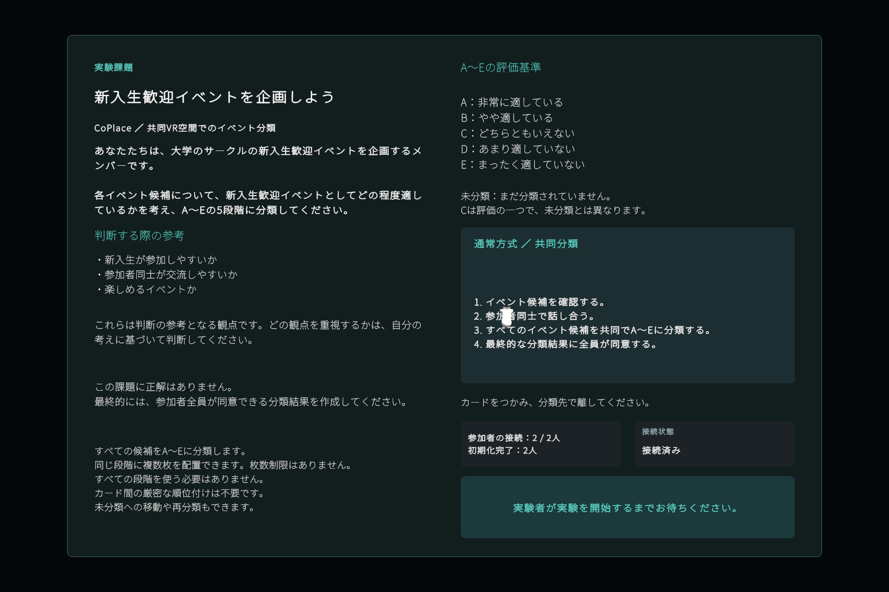

[準備前のLobby](../Documentation/ParticipantUI/lobby.png)も保存した。

### 独立回答

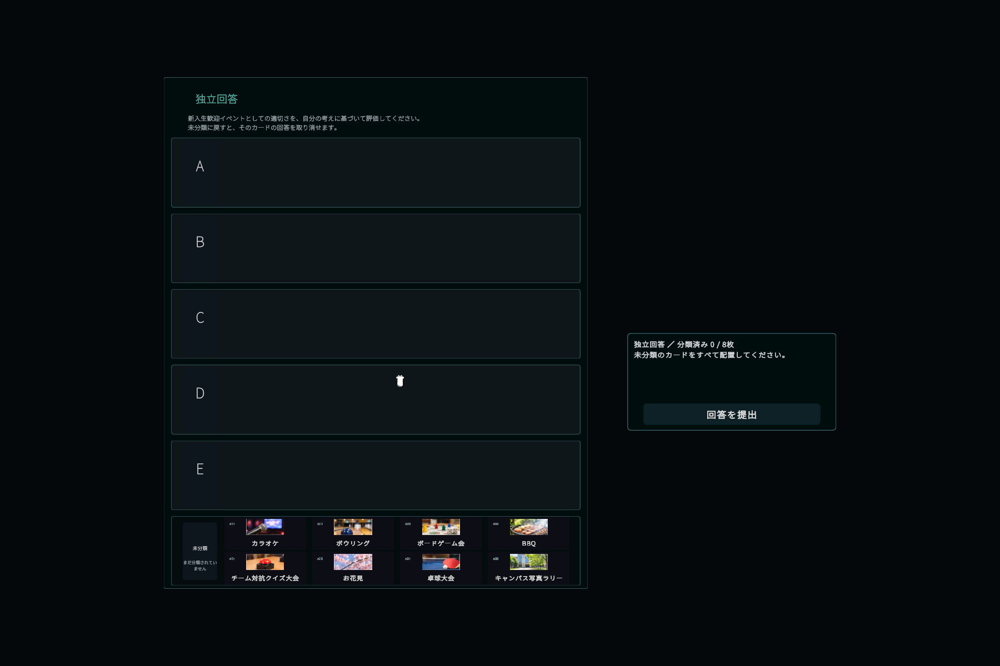

### 提出後の待機

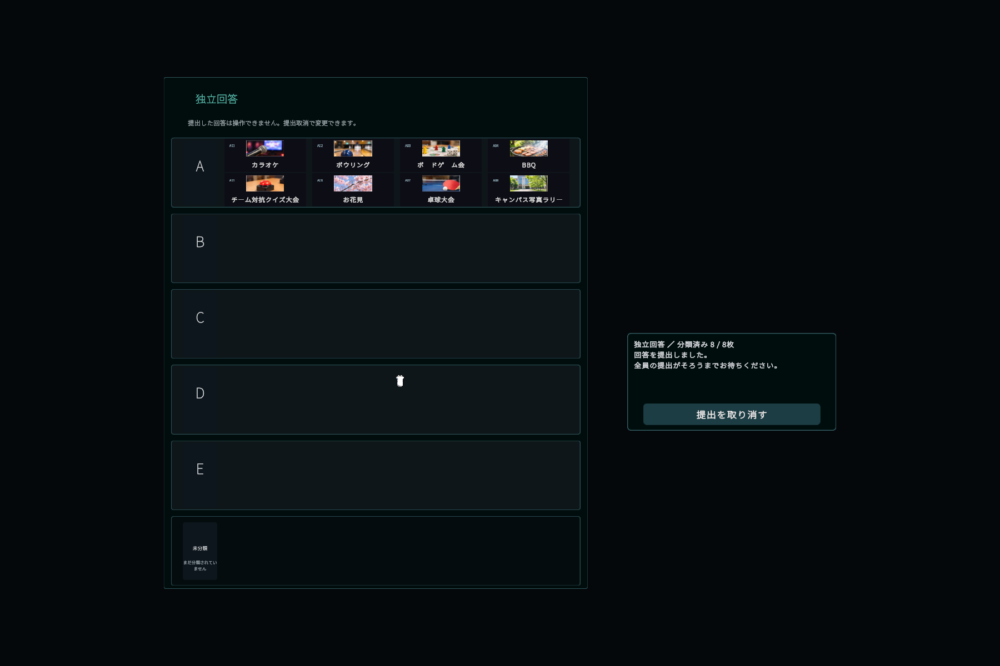

### 公開された独立回答・表示中

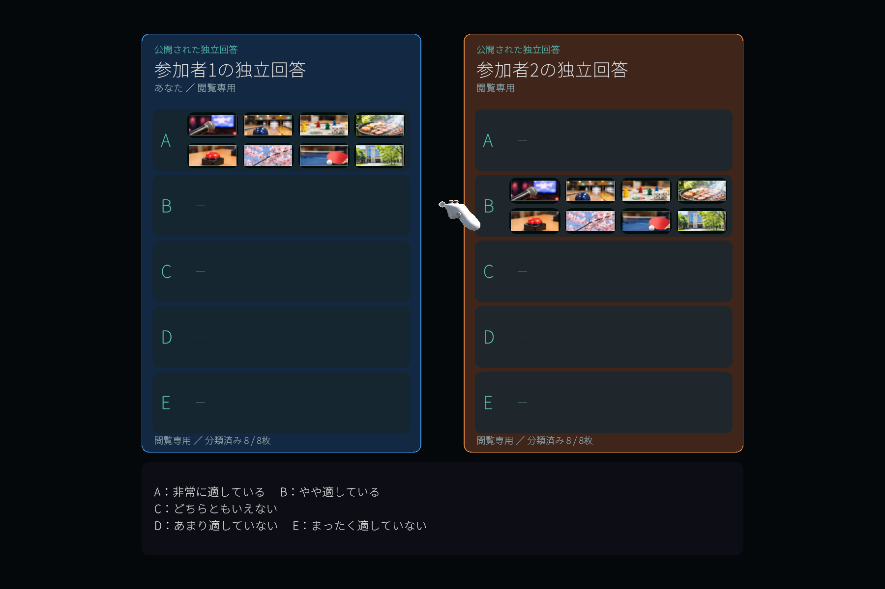

### 参照パネル非表示

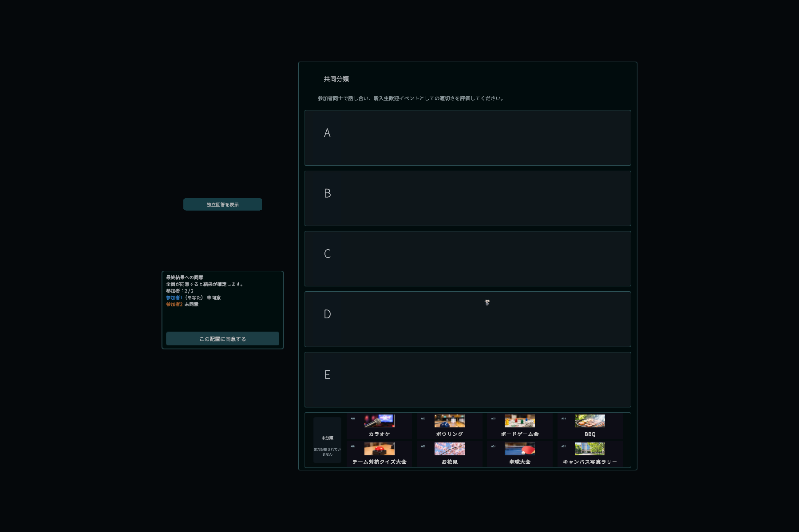

### 主ボードとの空間配置

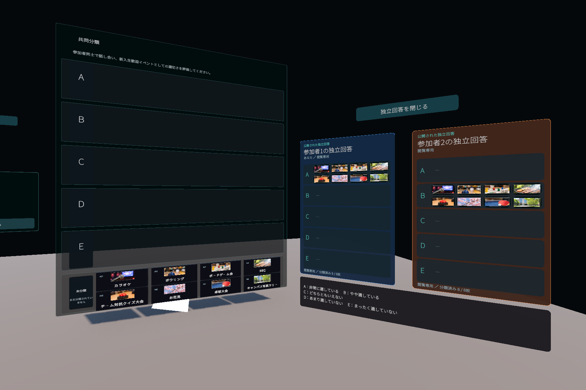

### 共同分類

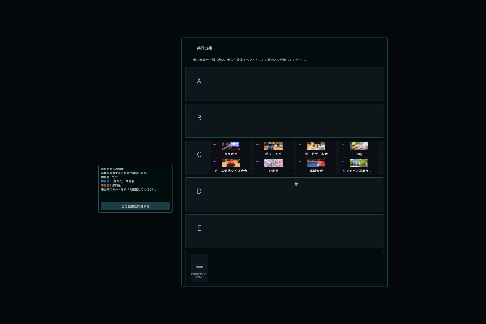

[提案方式の共同分類](../Documentation/ParticipantUI/shared-proposed.png)も保存した。

### 最終同意

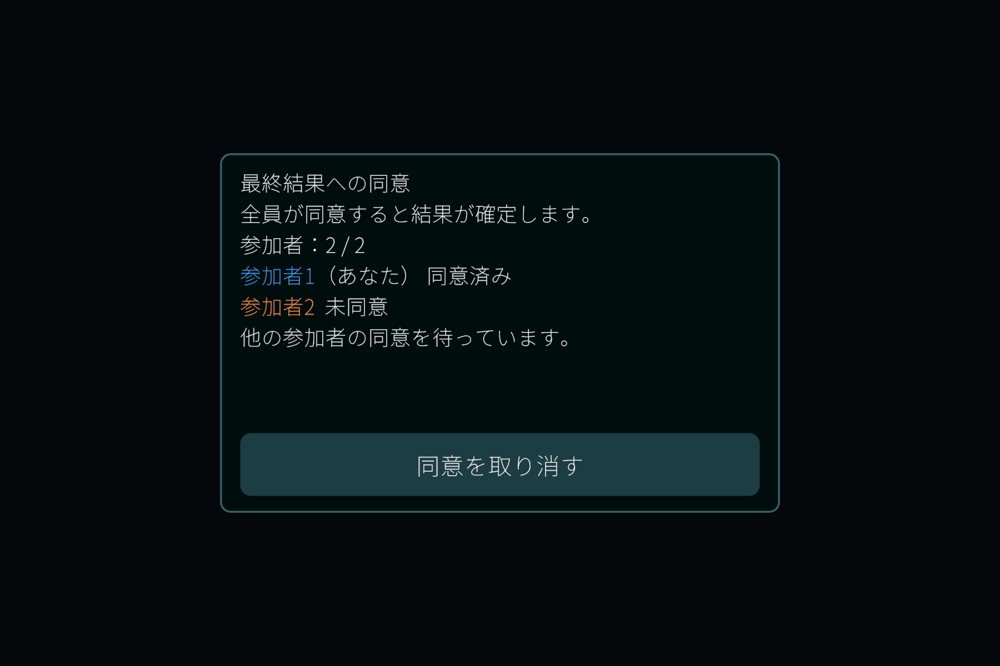

### 実験終了

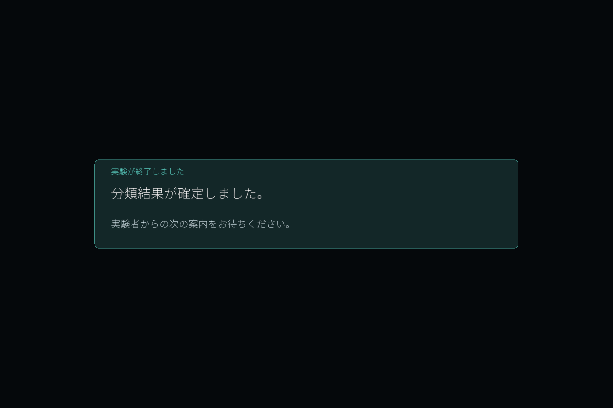

## 14. 実機検証を受けた追加改善（2026-11-20）

本節は第1〜13節の初版記録に対する追加修正である。終了時の参照表示、終了パネル、管理画面のボタンについては本節の仕様を優先する。作業開始時はcleanで、既存の両実装報告と現行コードを照合した。変更前のScripts／Editor／Sceneは `Temp/restore/participant-followup/` に保存した。

### 原因と修正内容

- **終了の認識**：従来の終了Canvasはメインボード上方に固定され、見出しも小さかった。既存の `ExperimentManager.CurrentState == Confirmed` を条件として、既存Canvasを参加者の現在の視線正面1.4mへ一度だけ配置する。追従HUDにはしない。幅1.4m・高さ0.55m、見出し66ptで「分類作業が終了しました」、続けて確定・労い・次の案内を表示する。通常／提案で同一の画面を使う。追加の確認操作、自動Reset、終了条件は追加していない。
- **終了前の操作表示**：共同分類の操作説明を非表示にし、既存の最終同意UIの非表示条件を維持した。参加者の参照パネルと開閉ボタンを終了時に閉じ、再接続でも終了済みなら開かない。確定Snapshotは保持し、実験者の閲覧は維持する。Resetで終了表示を消し、操作説明を復帰させる。
- **管理画面の状態誤認**：`IsExperimentStarted` は「このセッションで開始通知が存在する」ことを示し、最終確定後もtrueとなる。これだけを見た中断表示が原因だった。変更せずに `FinalAgreementManager.IsBoardConfirmed` を優先して表示を分岐する。正常終了後の確認文にも中断の説明を出さない。
- **CSV保存と確定の分離**：Loggerの既存保存済み集合から、現在セッションの最終回答と、提案方式では独立回答も保存済みかを返す読取propertyを追加した。さらに稼働・保存中・未保存件数・LastErrorを確認する。LastErrorが空だけでは保存完了にしない。保存中は次回準備を無効化し、失敗時の主ボタンは既存キューの再試行へつなぐ。
- **参照カードの表示**：参加者向け参照カードのCard IDラベルを生成せず、写真を中央配置した。従来のID用26px分を画像領域に戻し、8pxの余白で収める。写真のUV、内部Card ID、Tier、Snapshot、CSVは同一。実験者の既存カード表示、参加者名、本人識別、閲覧専用、開閉・再配置は維持する。

| 状態 | 管理画面の主ボタン |
|---|---|
| 開始前 | 新規セッションを準備する |
| 進行中・未確定 | 実験を中断する |
| 確定・必要データ未保存／保存中 | 実験データを保存しています（次回準備不可） |
| 確定・必要CSV保存済み | 次のセッションを準備する |
| 確定・保存失敗 | 保存を再試行する |

次回準備は確認後の既存 `ResetSession()` を利用する。Loggerの `TryFlushBeforeReset()`、Session ID発行、ACK、安全guardは維持した。`SESSION_ABORTED` の既存判定は「開始済み、かつ未確定」であり、変更していない。正常終了後のResetで中断イベントが生成されないことをCSVで検証した。

### 変更ファイル

- `Assets/Scripts/ExperimentResultUI.cs`：終了Canvasの文字・サイズ・初回配置、共同分類案内の表示復帰。
- `Assets/Scripts/ReadonlyParticipantBoardView.cs`：終了時の参加者表示制御、参照Card IDラベル除去と写真拡大。
- `Assets/Scripts/SessionResetUI.cs`：正常終了・保存状態による主ボタンと確認文の分岐。
- `Assets/Scripts/ExperimentLogger.cs`：必要回答CSV保存完了の読取propertyのみ。
- `Assets/Editor/ParticipantUISetup.cs`：再生成時も既存終了Canvasへ同じ表示設定を適用。
- `Assets/Resources/ParticipantJapanese SDF.asset`、`ExperimenterJapanese SDF.asset`：既存文字を保持して追加文言のグリフを追加。Static SDF、既存atlasサイズを維持。
- `Assets/Editor/ParticipantUIVerification.cs`、`ParticipantVerificationSession.cs`：正常終了・次回準備・画像対応・保存保護・Reset表示復帰の検証と撮影。
- `Assets/Editor/ExperimentResultVerification.cs`：保存失敗時に確認を開かず再試行を案内する前提へ更新。直接Reset APIの保存guardも検証。
- `Assets/Editor/ProposedSharedPlacementVerification.cs`：確定後は参照UIを閉じ、Snapshotは保持する前提へ更新。復元・確定・配置保護の検証意図は維持。
- `Documentation/ParticipantUI/`、`Documentation/ExperimenterUI/`、`Documentation/ParticipantUIVerification.json`：最新撮影・検証結果。
- `docs/participant-ui-followup-verification/`：今回の回帰検証結果。本節も更新。

Scene／Prefabの構造・配置は変更していない。既存Setup全体の再実行、Package追加、CSV列・通信キー・ログ計測境界の変更はない。uGUI package内のCanvas、RectTransform、Basic Layout、TextMeshProの文書を参照した。

### 検証結果と撮影

Unity EditorのPreview Scene、offline transport、検証専用GUIDログrootで実施。本番CSVは使用していない。最新の項目数と詳細は [今回の検証集計](participant-ui-followup-verification/summary.json) を参照。

最終10系統はEditor制御APIの5秒制限を避けるため、最新Assetsをコピーした隔離複製プロジェクトでバッチ実行した。全10系統PASS、参加者UIは1,636項目。公開74、共同分類44、提出14、Lobby39、Result78、Logger29、管理209、回答ログ378、回答保存18項目が成功した。各JSONのpassedとfailureも確認した。Consoleには意図した保存失敗注入と途中のAPIタイムアウト記録が残るため、これらを消去していない。

参加者UIでは通常／提案 × A／B × 1人／2人を通し、確定前の終了非表示、確定後の1.4m配置・固定、同意UI／参照UIの非表示、次回準備、正常終了時のSESSION_ABORTED非生成、Resetでの表示復帰、画像と内部Card ID／Snapshotの対応、過去CSVのバイト保持を検証した。保存失敗は専用出力rootをファイルで塞ぐ実際のIO失敗を注入し、UIと直接Resetの拒否、キュー再試行、Session ID不変、復旧後の次回準備を検証した。保存待ちの画面だけは、検証fixtureで最終回答の保存済みフラグを一時的に外したシミュレーションであり、実際の長時間非同期保存の撮影ではない。

全画像は**Editor／オフラインPreview**であり、Quest実機画面・実通信中のPlay画面ではない。作業Roomや本番ログへ接続せず状態を再現した。画像に映るコントローラーモデルはPreview Sceneの既存XRモデル。終了パネルの文言・文字枠、両方式での共通表示、参照写真の余白を撮影後に確認した。

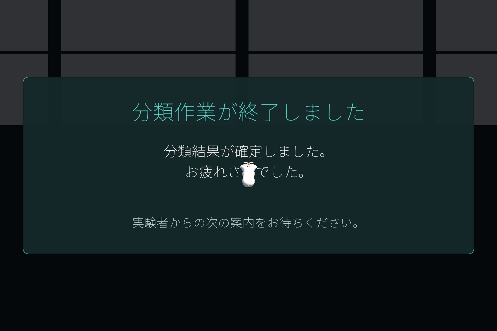

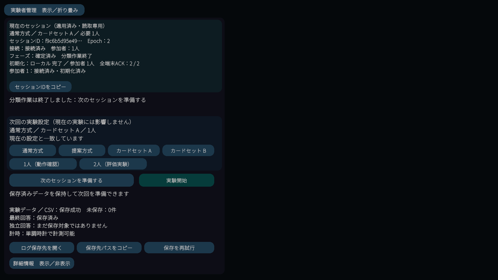
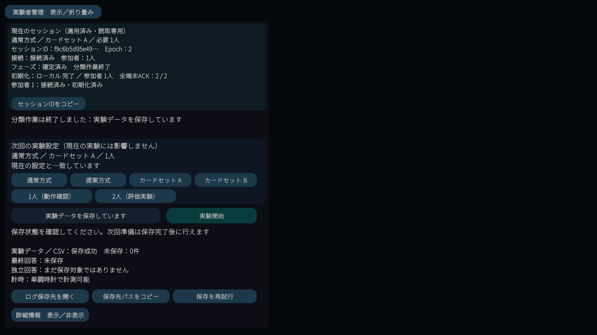
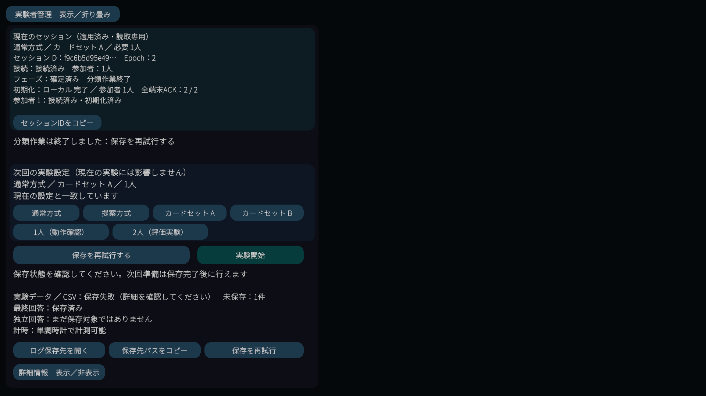

### 実機で再確認する項目

1. PCとQuestを今回の同じコードで用意し、テスト用ログ・Roomで通常方式A／提案方式Bを各1試行行う。確定前に終了パネルが出ないことを確認する。
2. 提案方式で参照パネルを開いたまま最終同意する。確定すると参照・同意・共同分類案内が消え、現在の視線正面に終了パネルが出ることを確認する。パネルは頭を動かしても追従せず、追加操作不要で終了する。
3. 見出し、確定、労い、待機案内の読みやすさを確認する。姿勢・視線角度による見え方、コントローラーが文字を遮らないかを確認する。
4. 管理PCで最終回答／独立回答の保存済みを確認し、「次のセッションを準備する」から確認・ACK完了を経て次回を開始する。前回CSV保持とSESSION_ABORTED非生成を確認する。未確定試行の中断は従来通り別途確認する。
5. Resetで終了表示・古い参照が残らないこと、次回の操作説明が戻ることを確認する。参照カードでCard IDが消え、Tierと写真が正しく対応し、開閉・再表示位置調整が従来通り動くことを確認する。
6. Quest 2台では両者への終了表示、片側が参照表示中の確定、終了後の再接続、両者ACK後の次回開始を確認する。

今回のQuest実機再検証、APK／IL2CPP全体のビルドは未実施。EditorコンパイルとAndroid向けC#コンパイルは成功した。1.4m・パネル実寸・写真サイズの最終的な快適性はQuest実機で確認する。表示改善以外の研究条件、回答・同意・Reveal・ネットワーク・CSV仕様を変更していない。

## 15. 実験課題の明確化・評価基準の統一（2026-11-24）

### 実装内容と既存変更の保持

課題を「新入生歓迎イベントを企画しよう」に統一し、両方式で同じ目的・判断観点・A〜Eの意味を表示した。方式ごとに異なるのは既存フローの手順説明だけである。正解判定、採点、推薦、追加の必須確認、時間計測境界は追加・変更していない。第14節の終了パネル、正常終了と中断の区別、保存保護、IDなしの拡大参照画像、開閉・終了・Reset時の処理は保持した。

開始時に第14節を含む未コミット変更とScene変更が存在した。これを含む最新状態を `Temp/restore/task-criteria/` に保存し、差分の基準として使用した。既存変更を破棄せず、専用 `ParticipantUISetup` だけで表示を更新した。既存Setup全体は再実行していない。

Lobbyは既存World Space Canvasを再利用し、左に課題・判断観点・到達目標・分類ルール、右に評価基準・現在の適用済み方式・手順・接続／初期化・開始待機を配置した。本文36〜40pt、課題名56ptを使い、自動縮小はしない。表示用テキストの生成は同名childを再利用し、Setupの繰り返しでも増殖しない。Lobbyに候補枚数は書かず、提出UIの枚数は従来通り実Card ID一覧から取得する。

メイン／個人ボードは既存の `TierCaption` を再利用した。元々A〜Eの補足欄は非表示だったため有効化し、32pt、意味の区切りによる2行表示へ変更した。行やカード置き場の幅を縮めず、アルファベットと補足文字だけを調整した。参照パネルは既存の画像寸法を維持し、ボードの下に共通凡例を追加した。1人では5行、2人では3行の凡例となる。すべて表示のみで、Raycast target、Collider、操作ボタンは追加していない。

### カードセットとの整合性

manifest `coplace_pilot_kit/metadata/card_manifest.csv`、contact sheet、Sceneのカードカタログ、既存Pilot検証を照合した。

| セット | イベント候補 |
|---|---|
| A | カラオケ、ボウリング、ボードゲーム会、BBQ、チーム対抗クイズ大会、お花見、卓球大会、キャンパス写真ラリー |
| B | ダーツ、映画鑑賞会、ゲーム交流会、公園ピクニック、料理交流会、カフェ交流会、バドミントン大会、ものづくり体験会 |

全16候補が新入生歓迎イベントの候補として評価可能で、課題と明らかに不整合なカードは見つからなかった。これは候補の望ましさやセット間の難度の同等性を判断したものではない。画像・イベント名・manifest・内部Card IDは変更していない。既存Pilot検証でもmanifestと画像バイト列、Sceneとの対応を再検証した。Developmentの料理カードは操作確認用であり、本課題の評価実験はA／Bを用いる。

旧配布用 `coplace_pilot_kit/participant_task_instructions.md` は人数20人程度・時期4〜5月・費用等の追加条件と別のTier補足を含んでいた。今回指定の課題に揃えて更新した。旧版と混用しないことを運用上の注意へ明記した。

### 最終的な共通課題説明

**新入生歓迎イベントを企画しよう**

あなたたちは、大学のサークルの新入生歓迎イベントを企画するメンバーです。

各イベント候補について、新入生歓迎イベントとしてどの程度適しているかを考え、A〜Eの5段階に分類してください。

**判断する際の参考**

- 新入生が参加しやすいか
- 参加者同士が交流しやすいか
- 楽しめるイベントか

これらは判断の参考となる観点です。どの観点を重視するかは、自分の考えに基づいて判断してください。

この課題に正解はありません。

最終的には、参加者全員が同意できる分類結果を作成してください。

追加の操作説明として、すべての候補をA〜Eに分類すること、同じ段階に複数枚を配置でき枚数制限がないこと、すべての段階を使う必要がないこと、厳密な順位付けが不要なこと、未分類への移動や再分類ができることを表示する。

### A〜Eの表示

| 内部Tier ID | 表示する意味 | ボード補足の改行 |
|---|---|---|
| A | 非常に適している | 非常に／適している |
| B | やや適している | やや／適している |
| C | どちらともいえない | どちらとも／いえない |
| D | あまり適していない | あまり／適していない |
| E | まったく適していない | まったく／適していない |
| Unclassified | まだ分類されていません | まだ分類されて／いません |

「／」は表の改行位置を表す。内部文字列には追加しない。Lobbyには「未分類：まだ分類されていません。Cは評価の一つで、未分類とは異なります。」と明記した。表示文言を同期・CSV値へ流用しない。

### 方式別の説明

通常方式：

1. イベント候補を確認する。
2. 参加者同士で話し合う。
3. すべてのイベント候補を共同でA〜Eに分類する。
4. 最終的な分類結果に全員が同意する。

提案方式：

1. 各自の考えに基づいてイベント候補を分類する。
2. 独立回答を提出する。
3. 全員の独立回答が公開される。
4. 公開された回答も参照しながら話し合い、共同で分類する。
5. 最終的な分類結果に全員が同意する。

共同分類の案内は両方式共通で「参加者同士で話し合い、新入生歓迎イベントとしての適切さを評価してください。」とした。独立回答では「新入生歓迎イベントとしての適切さを、自分の考えに基づいて評価してください。」と表示する。参照パネルの既存ボタンは「独立回答を表示／閉じる」のまま。方式の期待効果や候補の望ましい評価は表示しない。AppliedのSessionModeから手順を選び、次回Draftは表示しない。

### 今回の変更ファイル

| ファイル | 変更内容 |
|---|---|
| `Assets/Scripts/ExperimentLobbyUI.cs` | 共通課題・方式別手順、既存Canvasの2列レイアウトと表示専用テキスト |
| `Assets/Scripts/ParticipantUIStyle.cs` | 共通操作文、Tierの意味、明示改行、凡例 |
| `Assets/Scripts/PrivateTierBoardController.cs` | 独立回答の操作案内だけを変更 |
| `Assets/Scripts/ReadonlyParticipantBoardView.cs` | 画像領域の外へ共通凡例を追加。第14節の表示制御を維持 |
| `Assets/Editor/ParticipantUISetup.cs` | Tier補足欄・操作案内・Lobby再生成時の表示更新 |
| `Assets/Editor/ExperimentLobbySetup.cs` | 既存Lobbyの表示更新を共通の再生成処理へ接続 |
| `Assets/Editor/ParticipantUIVerification.cs` | 課題、評価基準、Applied／Draft、表示・重複防止、スクリーンショット検証を追加 |
| `Assets/Scenes/QuestSetup.unity` | 既存表示の文字・文字枠・有効状態、表示専用テキストの追加 |
| `Assets/Resources/ParticipantJapanese SDF.asset` | 追加文言の日本語グリフ |
| `coplace_pilot_kit/participant_task_instructions.md` | UIと共通の配布・読み上げ文へ更新 |
| `docs/task-criteria-verification/` | 自動検証・表示限定変更の監査 |
| `Documentation/TaskCriteriaUI/` | 今回の各画面のオフライン描画 |
| 本節 | 課題・表示・検証・実機手順 |

`ExperimentLobbyController`、TierZone、提出・同意・公開の判定、Logger、CSV Store、Session manager、カード画像・配置・SnapPoint・Colliderは今回変更していない。前回から残る未コミット変更は別途保持している。

### フォント・表示・回帰検証

既存の `ParticipantJapanese SDF` を使用し、Static SDF・2048×2048を維持した。変更前の324文字をすべて保持し、378文字へ追加した。カード用フォントや実験者用フォントは今回更新していない。uGUI package内のCanvas、RectTransform、Basic Layout、TMPの文書を参照した。

[検証集計](task-criteria-verification/summary.json) と [表示限定変更の監査](task-criteria-verification/presentation-audit.json) に結果を保存した。最新Assetsを隔離複製へコピーし、Unity 6000.3.17f1のEditor Preview Scene／offline transport／GUID別テストログで検証した。本番CSVは使用していない。Editor制御APIの5秒制限により、長い検証は複製プロジェクトでバッチ実行した。

最終結果：12系統すべてPASS。参加者UI 2,659、公開74、共同分類44、提出14、Lobby39、Result78、Logger29、管理209、Pilot433、回答ログ378、回答保存18、CardDrop1,163項目。最後の明示改行・再生成調整後には参加者UIを再実行して成功した。途中のAPIタイムアウトと意図した保存失敗注入のログは残し、Consoleは消去していない。

課題検証では、指定されたA〜Eの意味、両方式・A／B・1人／2人で同じ全文、適用済み方式の手順、Draft非表示、共同分類の共通案内、Cと未分類の区別、公開参照の凡例、繰り返し生成の重複防止を確認した。候補枚数はUIで固定せず、既存提出UIが実Card ID数を使うことを維持した。各フェーズの有効なテキストでフォント文字集合と文字枠を確認した。

既存検証では、両方式の完走、提出取消・再提出・同時公開、複数枚の同一Tier配置、最終同意、終了パネル、正常終了後の次回準備、SESSION_ABORTED非生成、保存失敗時の保護、Reset初期化、画像対応、回答CSVの値・件数・既存ファイル不変、単調時計とフェーズログを確認した。Scene監査は今回開始時の未コミットSceneを基準とし、削除0、既存通常Transform変更0、Collider変更0、既存研究スクリプトのserialized block変更0を確認した。

最初の描画レビューで補足欄の非表示を検出して修正し、次のレビューで意味の途中の改行を明示改行へ修正した。新しい撮影で全文・文字枠・凡例と画像領域の分離を再確認した。新たなPackageは追加していない。

### スクリーンショット

以下はすべて**Editor／オフラインPreview**。実装uGUIを実際の検証フローから描画したもので、Quest実機画面や実通信Playの撮影ではない。撮影用カメラのみが各対象を正面から捉え、他のCanvasを一時的に非表示にして復帰する。コントローラーモデルは既存XR rigのPreview描画である。

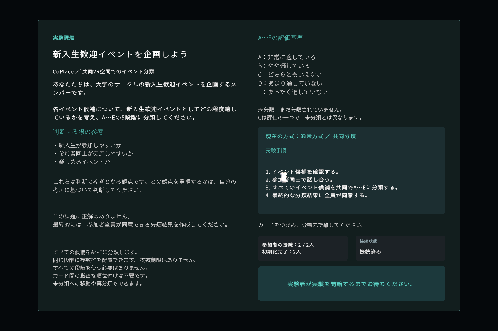
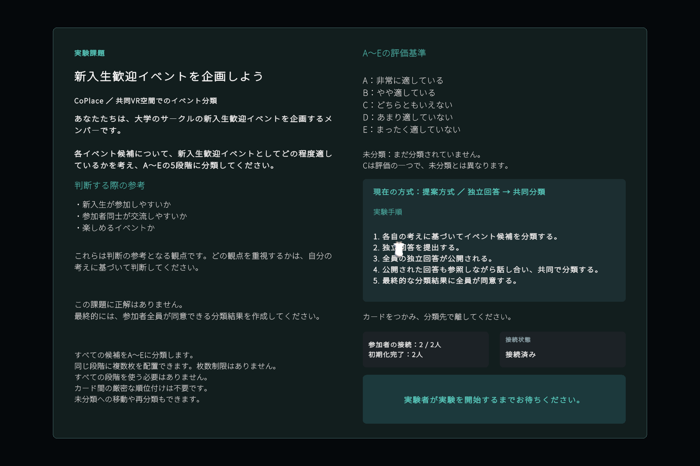
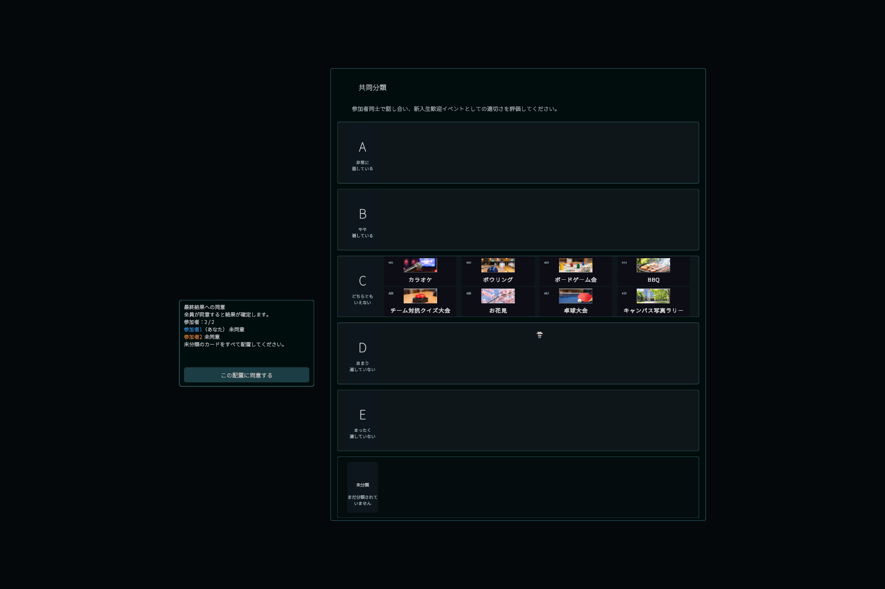
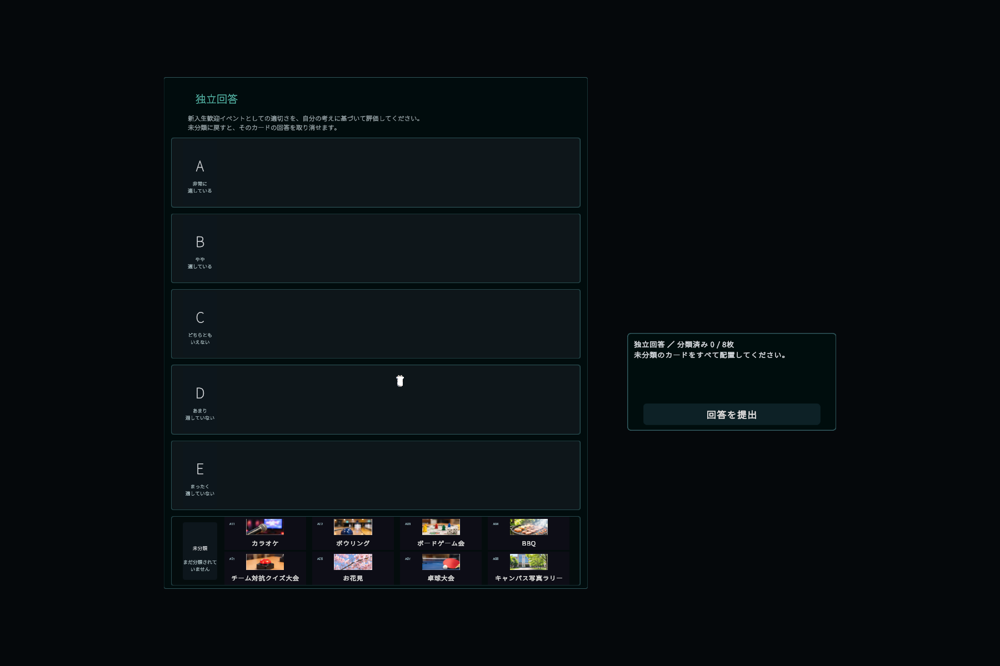
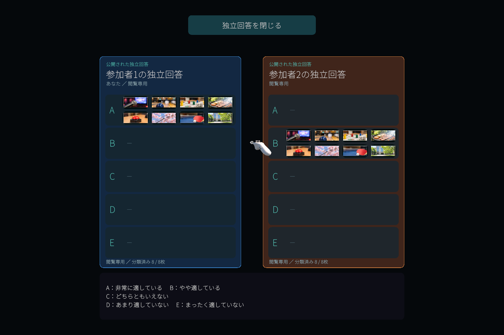
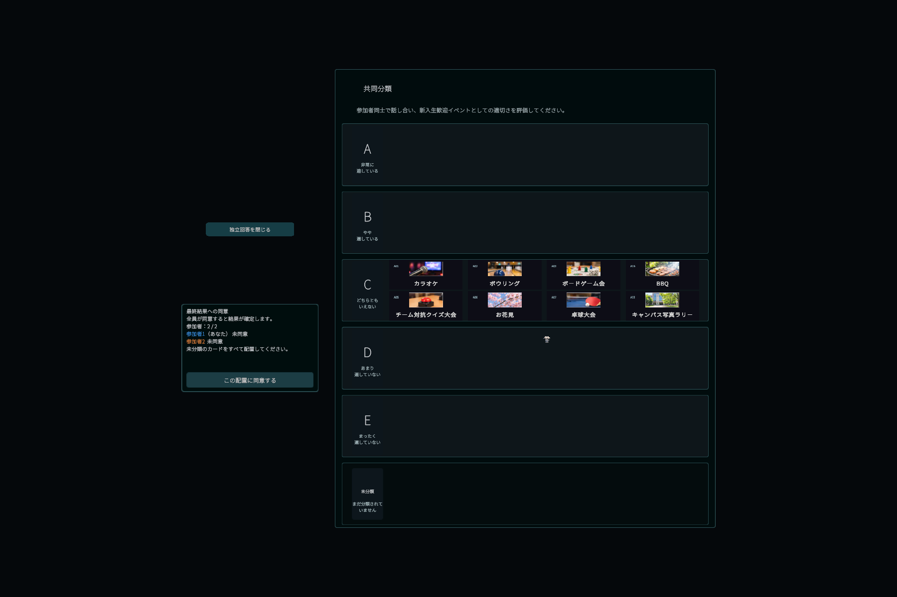

### 残存課題・Questでの確認手順

Quest実機の再検証とAPK／IL2CPP全体のビルドは今回未実施。Android向けC#コンパイルは成功した。Lobbyは横幅を広げたため、実機で2列を無理なく読める距離・視線移動量を確認する必要がある。32ptのTier補足、参照凡例の位置・読みやすさも実機で確認する。主観的な課題理解やセット間の難度の等価性は自動テストでは検証できない。

1. PC／Questを同じコードとSceneで用意し、テスト用Room／ログを使用する。A／Bを切り替え、両方式のLobbyで共通課題・判断観点・正解なし・到達目標・分類ルールを読めることを確認する。
2. 実験者がDraftの次回方式だけを変えても参加者の現在手順が変わらず、新規準備後にAppliedの手順へ切り替わることを確認する。
3. 通常方式で複数枚を同じTierへ置く。A〜Eの補足、Cと未分類の区別、カードのGrab／Release／スナップが従来通りであることを確認する。
4. 提案方式で個人ボードの同じ評価基準を確認し、提出・取消・再提出・公開を行う。公開前は他者回答が出ず、公開後はIDなしの写真と共通凡例が読め、開閉・再配置ができることを確認する。
5. 両方式で全員同意し、視線正面の終了表示と参照パネル非表示、保存済み表示、「次のセッションを準備する」、ACK後の再開、旧表示の消去を確認する。旧回答CSVと時間ログを保持していることも確認する。
6. Quest 2台では同時公開・凡例の両端末一致・ローカル開閉の独立性・両者への終了表示・再接続後の旧Session混入防止を再確認する。Quest 1台では1人設定で一連の動作を確認できる。
